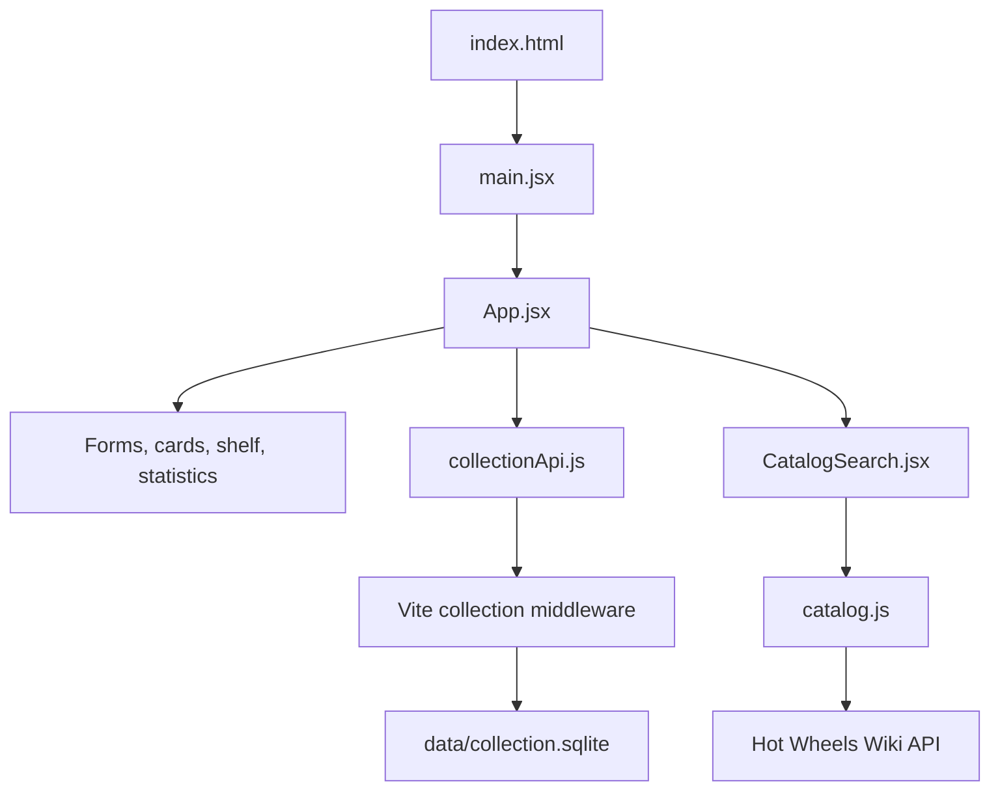
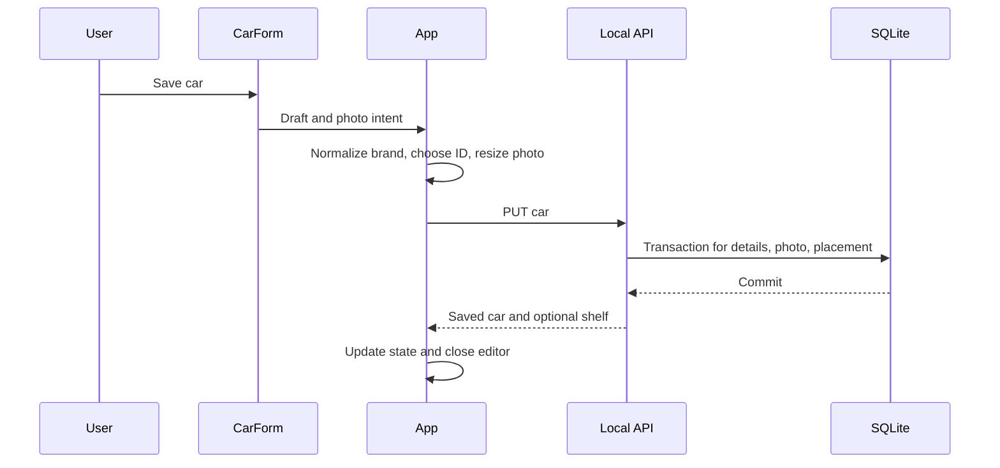

# Pit Lane — code guide and architecture

A detailed learning guide to the React Hot Wheels collection manager.

This guide describes the source in this project as reviewed on **12 November 2026**. It follows the application from the first browser request to SQLite, then explains the React components, shelf algorithms, photo processing, catalog parser, styling, and current limitations. The final appendix contains a collapsible snapshot of every authored source and configuration file so you can read the explanation and implementation together.

The examples use fictional cars and identifiers. Your personal database and photos are excluded from this document.

## Contents

- [Run the project](#run-the-project)
- [Architecture](#architecture)
- [Source map](#source-map)
- [Data model and persistence](#data-model-and-persistence)
- [React mechanisms in this app](#react-mechanisms-in-this-app)
- [App and filters](#app-and-filters)
- [Editing and saving cars](#editing-and-saving-cars)
- [Collection cards and the SVG placeholder](#collection-cards-and-the-svg-placeholder)
- [Shelf algorithms and interactions](#shelf-algorithms-and-interactions)
- [Photos and framing](#photos-and-framing)
- [Online catalog](#online-catalog)
- [Statistics](#statistics)
- [Server and SQLite](#server-and-sqlite)
- [Styling and responsive layout](#styling-and-responsive-layout)
- [Code review findings](#code-review-findings)
- [Debugging and verification](#debugging-and-verification)
- [Learning exercises](#learning-exercises)
- [JavaScript syntax reference](#javascript-syntax-reference)
- [Official references](#official-references)
- [Complete source snapshot](#complete-source-snapshot)

## Run the project

### Requirements and commands

The package declares Node.js `^22.16.0 || >=24.0.0`. The backend imports `node:sqlite`, including its backup function, so the Node version matters even though the visible interface is a React app. Use a compatible Node installation and run commands from the project directory.

```sh
npm ci
npm run dev
```

Open the local URL printed by Vite. It is normally `http://localhost:5173/`, but the terminal output is authoritative if that port is occupied.

| Command                | Result                                                   |
| ---------------------- | -------------------------------------------------------- |
| `npm ci`               | Installs the dependencies recorded in the lockfile       |
| `npm run dev`          | Starts Vite and installs the local collection API        |
| `npm run build`        | Builds the browser application into `dist/`              |
| `npm run preview`      | Serves the build locally and installs the collection API |
| `npm run format`       | Formats the explicit source/configuration targets        |
| `npm run format:check` | Reports formatting differences without writing them      |

The formatter targets are `src server index.html vite.config.js prettier.config.js package.json`. This README and `package-lock.json` are outside that explicit list. To format this Markdown file separately, run `npx prettier --write README.md`. Prettier is installed locally, pinned to version `3.10.0`.

The reviewed lockfile records React and React DOM `19.3.1`, Vite `7.3.8`, and Prettier `3.10.0`. The React and Vite ranges in `package.json` allow compatible updates. Committing the lockfile makes the installed dependency tree reproducible.

### What GitHub can contain

Commit `src/`, `server/`, the root configuration files, `index.html`, `package.json`, `package-lock.json`, and this README. The existing `.gitignore` excludes `node_modules/`, `dist/`, and `data/`.

The app requires a running Node process for collection storage. Publishing only `dist/` on GitHub Pages would supply the interface but leave the collection endpoints unavailable. The API is registered through Vite hooks in the current project, and a separate production server has not been implemented.

### Backup and restore

The interface provides two exports.

| Export        | Contents                                                          |
| ------------- | ----------------------------------------------------------------- |
| SQLite backup | Car details, photo BLOBs, and shelf settings                      |
| JSON export   | Car details and shelf settings, with photo presence flags omitted |

Photo framing values are part of the car details and therefore appear in JSON, but image bytes do not. The UI has no import or restore command.

To restore a downloaded SQLite backup manually, stop the app, keep a copy of the current database, place the backup at `data/collection.sqlite`, and restart the app. Use a backup created by this app. A schema migration framework for incompatible future database formats has not been added.

## Architecture

The browser owns interaction state and rendering. The Node process owns the SQLite connection. Catalog requests go directly from the browser to Hot Wheels Wiki.



A single `App` component holds the collection and passes it to multiple views. A child asks for an operation through a callback prop. For example, a shelf slot calls `onChange(settings)`, which reaches `App.changeShelf`, sends the request, then updates the state using the server response.

The application has no router, Redux store, Context provider, custom Hook, or component library. Plain functions handle validation, sorting, parsing, and requests. This makes the boundaries visible while learning.

### Startup path

1. The browser loads `index.html`.
2. The module script imports `src/main.jsx`.
3. `createRoot` mounts `App` inside `React.StrictMode`.
4. App initially renders with an empty car array and `ready === false`.
5. Its startup effect requests `GET /api/pit-lane/collection`.
6. If the server has no shelf setting, App requests initialization using old browser data or sample cars.
7. App stores the returned cars and shelf, then marks the collection ready.
8. Derived arrays and the rendered views update.

`initialized` comes from the existence of the database's shelf setting. An initialized collection may contain zero cars. Deleting every car does not trigger sample-car initialization on the next visit.

## Source map

| File                                                         | Responsibility                                                          | Read it when                                |
| ------------------------------------------------------------ | ----------------------------------------------------------------------- | ------------------------------------------- |
| [index.html](index.html)                                     | HTML root and module entry                                              | Tracing the first load                      |
| [src/main.jsx](src/main.jsx)                                 | React root, StrictMode, global CSS import                               | Learning mounting                           |
| [src/App.jsx](src/App.jsx)                                   | Shared state, loading, filters, CRUD callbacks, panel composition       | Understanding coordination                  |
| [src/CarForm.jsx](src/CarForm.jsx)                           | Editable draft, field validation, photo selection, removal confirmation | Learning controlled forms                   |
| [src/CarCard.jsx](src/CarCard.jsx)                           | Gallery card, image fallback, SVG illustration, action buttons          | Learning presentational components          |
| [src/Shelf.jsx](src/Shelf.jsx)                               | Shelf and tray, moves, photo mode, finding a car                        | Learning refs and event-driven interactions |
| [src/CollectionStatistics.jsx](src/CollectionStatistics.jsx) | Grouping and count bars                                                 | Learning derived data                       |
| [src/CatalogSearch.jsx](src/CatalogSearch.jsx)               | Search UI, request cancellation, status transitions                     | Learning async UI                           |
| [src/catalog.js](src/catalog.js)                             | Wiki requests and HTML table extraction                                 | Understanding external data adaptation      |
| [src/PhotoFraming.jsx](src/PhotoFraming.jsx)                 | Photo preview, object URL lifecycle, framing controls                   | Learning effects and browser resources      |
| [src/collectionApi.js](src/collectionApi.js)                 | Collection HTTP requests and photo resizing                             | Understanding the browser/server boundary   |
| [src/collection.js](src/collection.js)                       | Shared validators, defaults, sorting, placement reconciliation          | Learning pure domain functions              |
| [src/cars.js](src/cars.js)                                   | Sample cars and paint-color mapping                                     | Understanding fallback data                 |
| [src/styles.css](src/styles.css)                             | Layout, theme variables, shelf sizing, interaction styles               | Learning how CSS reflects React state       |
| [server/collection.js](server/collection.js)                 | HTTP routes, validation, transactions, backup streaming                 | Understanding persistence                   |
| [vite.config.js](vite.config.js)                             | Installs the API in dev and preview                                     | Understanding local hosting                 |
| [package.json](package.json)                                 | Scripts, dependencies, Node requirement                                 | Running the project                         |
| [package-lock.json](package-lock.json)                       | Resolved dependency graph and integrity information                     | Reproducing installations                   |
| [prettier.config.js](prettier.config.js)                     | Single quotes and semicolons                                            | Formatting code                             |
| [.gitignore](.gitignore)                                     | Excludes generated files and personal database                          | Preparing a Git commit                      |

## Data model and persistence

### A car

The following object illustrates the shape returned by the server.

```js
{
  id: 'example-car-id',
  brand: 'Nissan',
  model: 'Skyline GT-R (R34)',
  year: 1999,
  releaseYear: 2024,
  series: 'HW J-Imports 3/10',
  releaseColor: 'Metalflake Blue',
  toyNumber: 'EXAMPLE',
  catalogTitle: 'Nissan Skyline GT-R (R34)',
  photoFrame: { zoom: 1, x: 0, y: 0 },
  hasPhoto: true
}
```

| Property       | Meaning and behavior                                            |
| -------------- | --------------------------------------------------------------- |
| `id`           | Stable car identity. New cars receive a UUID in App             |
| `brand`        | Brand text used for filters, groups, and display                |
| `model`        | Display name                                                    |
| `year`         | Real-car year. A nullish value displays “fantasy casting”       |
| `releaseYear`  | Year of the toy release                                         |
| `series`       | Release-series text, possibly including a number such as `3/10` |
| `releaseColor` | Free-text release color                                         |
| `toyNumber`    | Toy/product identifier                                          |
| `catalogTitle` | Wiki page title used to construct a source link                 |
| `photoFrame`   | Zoom and position applied while displaying the photo            |
| `hasPhoto`     | Calculated by the server from the photo table                   |
| `color`        | Optional legacy paint key, retained for older records           |

There are two distinct dates because a 2024 toy can represent a 1999 real car. Sorting and the Year filter use `year`. The release summary uses `releaseYear`.

The app treats every missing real-car year as a fantasy casting, including a real vehicle whose year has simply not been entered. The label is a display convention derived from missing data.

### Shelf settings

```js
{
  rowCount: 2,
  slotsPerRow: 3,
  placement: ['a', null, 'b', 'c', null, null, 'd']
}
```

Capacity is `2 * 3 = 6`. Indices 0 through 5 belong to the visible shelf. Index 6 and later belong to the tray. The example puts car `d` in the tray.

The model is one flat list. For a slot at zero-based row `r` and column `c`, the index is `r * slotsPerRow + c`. A missing `placement` enables the default sorted arrangement. An empty array is truthy in JavaScript and represents an explicit placement value.

### Where values live

| Storage location                             | Values                                                        | Lifetime                                                |
| -------------------------------------------- | ------------------------------------------------------------- | ------------------------------------------------------- |
| SQLite `cars.details`                        | JSON car details                                              | Across restarts                                         |
| SQLite `car_photos.webp`                     | One WebP BLOB per car                                         | Across restarts                                         |
| SQLite `settings`                            | Shelf dimensions and placement                                | Across restarts                                         |
| Browser localStorage `pit-lane:theme`        | `dark` or `light`                                             | Across visits on that browser origin                    |
| Legacy localStorage `pit-lane:collection:v1` | Earlier car collection                                        | Read only during first database initialization          |
| React state                                  | Search text, open panels, drafts, selection, request statuses | Until the owning component unmounts or the page reloads |
| React `photoVersions`                        | Per-car image request revision                                | Current mounted App                                     |

SQLite lives in `data/collection.sqlite`, resolved relative to `vite.config.js`. Photos are stored inside this database. There is no separate photos directory.

### Validation boundaries

`isCar` checks IDs, basic field types, integer years, legacy paint membership, and framing. It permits missing years using `== null`, which matches both `null` and `undefined`. It allows unknown extra properties and does not enforce the form's string lengths or year ranges.

`isShelf` checks integer dimensions, 1–20 rows, 1–12 slots per row, and a placement array containing nulls or unique nonempty strings. It does not check that every placement ID exists in the car table.

`isPhotoFrame` accepts finite zoom from 0.5 to 3 and finite x/y offsets from -50 to 50.

These helpers run in both browser-related code and the server. Shared validation reduces drift, but the current UI and server enforce different levels of detail.

## React mechanisms in this app

### Components, props, and callbacks

A component is a function that returns JSX. React calls it to describe the interface for the current props and state.

`CarCard` receives a car through props. It receives `onEdit` and `onFindOnShelf` as functions. Clicking a button invokes a callback created by App, so the child can request a change without owning the entire collection.

```jsx
<CarCard
  car={car}
  onFindOnShelf={() => {
    setShelfOpen(true);
    setShelfLocation({ carId: car.id });
  }}
/>
```

This is the exact direction used throughout the app. Data travels down through props, and user intent travels up through callback calls.

### State and render snapshots

A setter schedules a new render. The variables in the currently running handler still belong to the render that created that handler. This matters after `await`, where the server response arrives later.

When the next value depends on the previous value, the app uses a functional updater.

```js
setCars((previous) => [...previous, car]);
setDarkMode((enabled) => !enabled);
```

The first expression returns a new array. It preserves the earlier array and gives React a new state value. Editing a car uses `map` to replace the matching object. No component should sort the `cars` state array directly in place.

Read the official explanation of state snapshots alongside these examples. [React state snapshots](https://react.dev/learn/state-as-a-snapshot)

### Derived values

`brands`, `visibleCars`, count maps, shelf occupancy, and statistics are calculated during rendering. They can be recalculated from the source data, so the app does not maintain them as additional state.

If both `cars` and a separate `filteredCars` state existed, every save, delete, and filter change would have to keep them synchronized. The current implementation calculates the view from the current inputs.

These calculations currently run on every relevant component render. There is no `useMemo`. For the intended small collection, simple calculations keep dependencies easy to inspect. Measure rendering before adding caching.

### Effects and cleanup

Effects connect rendered state to things outside React. App loads the collection, updates the document theme, and manages the highlight timer. CatalogSearch cancels pending requests when removed. PhotoFraming releases temporary object URLs. Shelf focuses and scrolls a DOM node.

An effect's cleanup runs when its dependencies change or its component unmounts. The startup effect's empty dependency array ties it to mounting. StrictMode in development also exercises effect setup and cleanup, which is why abort handling and idempotent initialization matter.

Save requests are triggered by submit handlers. They are not automatically sent every time a draft renders. [React effects](https://react.dev/learn/synchronizing-with-effects)

### Refs

Refs hold values that must survive rendering without themselves causing a render.

| Ref                            | Purpose                                            |
| ------------------------------ | -------------------------------------------------- |
| `CountedFilter.trigger`        | Returns focus to the dropdown button               |
| `CatalogSearch.pendingRequest` | Keeps the current AbortController                  |
| `Shelf.locatedSlot`            | Points to the button to focus and scroll into view |

A DOM ref becomes available after React commits the rendered element. Shelf waits until its effect to use the selected node.

### Keys and component lifetime

Gallery cards use `car.id` as their key so identity follows the car across sorting. Form identity uses the existing car ID or a catalog/new-car key. A changed key creates a fresh form state initialized from the new record.

Catalog results use page IDs. Release entries use their serialized content after deduplication. Shelf rows and slots use positional identity because their purpose is to represent locations. `ShelfPhoto` also receives a car key so its failed-image state belongs to the car occupying the slot.

Shelf stays mounted and receives a `hidden` attribute. Closing and reopening it preserves its local Photo mode and selection state. CatalogSearch and CarForm are conditionally mounted, so closing them discards their local state. A page reload resets these temporary choices. [React state preservation](https://react.dev/learn/preserving-and-resetting-state)

### Controlled inputs

A controlled input gets its `value` from React state and updates that state in `onChange`. CarForm's generic handler uses the field's `name` as the object property to update.

Number fields still produce strings through `event.target.value`. The form deliberately keeps an empty string while editing and converts the submitted value to a number or a nullish value.

The file input is handled differently. Its selected `File` is read from `event.target.files`, and React does not assign a file-input value.

## App and filters

### State inventory

| State                                        | Initial value                 | Responsibility                                      |
| -------------------------------------------- | ----------------------------- | --------------------------------------------------- |
| `darkMode`                                   | Read lazily from localStorage | Theme choice                                        |
| `cars`                                       | `[]`                          | Server-backed collection                            |
| `shelf`                                      | `defaultShelf`                | Server-backed layout                                |
| `ready`                                      | `false`                       | Enables operations after startup                    |
| `saving`                                     | `false`                       | Disables many conflicting UI actions during a write |
| `storageError`                               | Empty string                  | Latest collection request error                     |
| `photoVersions`                              | `{}`                          | Changes photo URLs after replacement/removal        |
| `brandFilter`, `yearFilter`                  | Empty strings                 | Selected dropdown filters                           |
| `carSearch`                                  | Empty string                  | Collection text search                              |
| `editor`                                     | `null`                        | Current form record and optional catalog prefill    |
| `catalogOpen`, `shelfOpen`, `statisticsOpen` | `false`                       | Panel visibility                                    |
| `shelfLocation`                              | `null`                        | Car currently requested by Find on shelf            |
| `announcement`                               | Empty string                  | Accessible save/removal announcement                |

### Loading and legacy migration

`loadCars()` tries to parse the old localStorage key. It accepts an array only if every entry passes `isCar`. Missing, invalid, or blocked storage falls back to six sample cars. A valid empty array remains empty.

The startup effect first asks the server for its collection. Legacy data is consulted only when `initialized` is false. The server repeats the initialization check inside a transaction. This prevents two initialization requests from replacing an already initialized collection.

The AbortController belongs to that effect execution. On cleanup it aborts pending fetches. The code also checks `signal.aborted` after awaiting data to avoid applying a result from an abandoned effect.

### Search semantics

The collection search builds a lowercase string from brand, model, series, release color, and toy number. The query is trimmed, split on whitespace, and emptied terms are removed.

Every term must occur somewhere in the combined text.

| Query         | Meaning                                                               |
| ------------- | --------------------------------------------------------------------- |
| `nissan blue` | The car's combined searchable fields contain both “nissan” and “blue” |
| `R34`         | Case-insensitive substring search                                     |
| `1999`        | Matches only if this text appears in a searchable text field          |
| Empty query   | Includes all cars allowed by dropdowns                                |

The year fields are excluded from this combined string. Searching “1999” does not directly compare the real-car year.

### Dependent dropdowns

The filters use a deliberately asymmetric calculation for each option list.

- Brand counts are built from cars matching the selected year.
- Year counts are built from cars matching the selected brand.
- Visible cards match the brand, year, and all search terms.
- Text search does not change either dropdown's counts.
- Nullish years are omitted from individual Year options.
- “All years” includes cars without a year.

For example, if Nissan has two cars from 1989 and one from 1999, choosing Nissan offers `1989 (2)` and `1999 (1)`. Choosing 1989 limits Brand options to brands represented in 1989.

Year options have numeric keys in `yearCounts`. App stores `yearFilter` as a string, converts it to a number for the CountedFilter value, and converts the chosen value back to a string. This preserves compatibility with string comparisons against car years.

### CountedFilter

This helper is defined outside App so its component identity stays stable across App renders. It renders a trigger button and, when open, a group of option buttons.

`close()` hides the group and focuses the trigger. Blur closes the group only when focus leaves the wrapper. Escape closes it and stops propagation. The separate count span makes the count lighter than the label.

It is a button group with tab navigation. A native select's arrow-key selection, type-to-search, and mobile picker behavior are not implemented.

### Sorting and post-save visibility

Gallery results are sorted by real-car year, then model name. Missing years use `Number.MAX_SAFE_INTEGER` as their comparison value and appear after dated cars.

After saving, App clears dropdown filters that would exclude the saved car. The text search is preserved. A successful save can therefore still leave the car outside the current gallery result.

Deleting a car replaces the entire cars/shelf state from the server response. It clears selected filters when the remaining data cannot support them. This is different from a successful edit, which replaces only the matching car object.

## Editing and saving cars

### CarForm initialization

`initial = car ?? prefill` selects an existing record for editing or a catalog release for a new draft. The local draft copies the editable fields once when the component mounts.

The initial value passed to `useState` is not reapplied automatically when props change. App's form key handles switching between records by resetting the component when identity changes.

The form tracks five pieces of local state.

| State               | Meaning                                        |
| ------------------- | ---------------------------------------------- |
| `draft`             | Text, years, and photo-frame values            |
| `error`             | Local validation message                       |
| `photoFile`         | Newly selected browser File                    |
| `removePhoto`       | Explicit removal request for an existing photo |
| `confirmingRemoval` | Shows the two-step car removal UI              |

### Field updates and validation

`updateField` extracts `name` and `value` from the input and returns a new draft object.

```js
setDraft((previous) => ({
  ...previous,
  [name]: value,
}));
```

The computed property name allows one handler to update `brand`, `model`, `year`, and other fields.

Native HTML validation enforces required inputs, maximum lengths, and numeric bounds during normal form submission. `handleSubmit` additionally trims brand/model and checks that they are nonempty.

The normal form allows real years from 1886 to 2100 and release years from 1968 to 2100. The shared server validator checks integer types but does not repeat these bounds.

Submitting creates a fresh car-details object. Blank real-car year becomes `null`. Empty optional text and release-year fields become `undefined`, which JSON serialization omits. Existing legacy paint is retained through `car?.color`.

### Saving a car, step by step



1. App finds an existing brand with the same case-insensitive name and reuses its spelling.
2. Existing cars retain their IDs. A new draft receives `crypto.randomUUID()`.
3. App marks the write in progress and clears the earlier error.
4. A new file is resized and encoded. A removal request produces `null`. No photo change produces `undefined`.
5. The PUT request sends the car and photo intent.
6. The server adds new cars beyond shelf capacity, writes details, and changes photo data in a transaction.
7. App applies returned shelf settings when a new car was appended to the tray.
8. App maps over existing cars for an edit or appends a new car.
9. A changed photo increments that car's image URL version.
10. App adjusts dropdown filters, announces success, and closes the editor.
11. Any error remains visible through `storageError`. The finally block clears `saving`.

This is a server-confirmed UI update. The collection is updated after a successful response.

### Three photo intents

| JavaScript value | Sent JSON                | Server action              |
| ---------------- | ------------------------ | -------------------------- |
| `undefined`      | `photo` property omitted | Preserve existing image    |
| `null`           | `"photo": null`          | Delete existing image      |
| Base64 string    | `"photo": "..."`         | Validate and replace image |

This distinction is important. Collapsing undefined and null into the same serialized value would accidentally delete photos when editing text.

### Removing a car

Clicking Remove car changes local form state to show confirmation. Keep car exits confirmation. Confirm removal calls App's `removeCar`.

The database deletes the car. Its photo is removed through the foreign key cascade. Any explicit shelf reference becomes `null`, preserving the hole. The response contains the refreshed collection.

The request is destructive by design and has a visible confirmation step. There is no undo history. If a DELETE response is lost, repeating the delete does not recreate the car.

### Async closures

`saveCar` uses the `editor` object from the render that started the save. React's functional state updater supplies the latest car array, but it does not replace every other value captured by that handler. Understanding that distinction is useful when debugging interactions during an in-flight operation.

## Collection cards and the SVG placeholder

### CarCard responsibilities

The card calculates a paint color, builds the photo URL, assembles release text, and renders its two action buttons. It delegates edits and finding a car through callbacks.

Its only local state is `failedPhoto`, holding the failed URL. `showPhoto` requires both a server photo flag and a URL that has not failed. An image error exposes the existing illustration. Incrementing `photoVersion` creates a new URL and permits a fresh attempt.

The server sends `Cache-Control: no-store` for photos. The version query also gives React a new image identity and clears the practical effect of the previous failed-URL marker. It is an in-session counter, not a database revision.

### SVG structure

The sports car is vector geometry drawn directly in JSX. Its geometry is shared across all cars. It is a placeholder illustration, so changing brand does not generate an accurate silhouette of that model.

| SVG element or expression         | Role                                                   |
| --------------------------------- | ------------------------------------------------------ |
| `viewBox="0 0 280 112"`           | Establishes the SVG coordinate system                  |
| `coupeBody`                       | Path data for the outer shell                          |
| `defs` and linear gradients       | Reusable light and glass fills                         |
| `useId()`                         | Gives each card unique gradient IDs                    |
| `translate(5 14) scale(.57)`      | Positions and scales the larger underlying drawing     |
| Ellipse beneath the body          | Ground shadow                                          |
| Paths and strokes                 | Body panels, windows, lights, intakes, reflections     |
| `[90, 367].map(...)`              | Places two wheel assemblies                            |
| `[0, 72, 144, 216, 288].map(...)` | Rotates five wheel spokes                              |
| `aria-hidden="true"`              | Marks the decorative SVG as redundant to the card text |

Path commands such as `M`, `L`, `Q`, and `z` describe movement, straight lines, quadratic curves, and path closure. Lowercase commands use relative coordinates. The long coordinate strings are drawing data. Their visual role is explained by the existing comments dividing the body, glass, intake, and headlamp sections.

The same `coupeBody` is drawn twice, first with the paint fill, then with a light gradient. Later elements draw over earlier elements. Wheel circles build concentric tire, rim, hub, and spoke layers.

### Text layout

Release details are filtered to remove empty pieces and joined with a middle dot. When present, the description has `min-height: 2lh`, reserving two line heights. A card with no release details omits that paragraph entirely.

The year uses the nullish fallback to “fantasy casting.” The catalog link is built from the saved wiki title. Find on shelf and Edit have descriptive accessible names including the car name.

## Shelf algorithms and interactions

### arrangeCars

This shared pure function first builds a sorted copy of the collection, grouped by brand, then real-car year, then model.

Without placement it returns that sorted list. With placement it builds a Map from car IDs to car objects and a Set of IDs already mentioned in the placement. Cars absent from the placement are collected as `unplaced`.

Each placement position resolves to its car object. An unknown ID or null position receives the next unplaced car when one exists. Remaining unplaced cars are appended.

```js
const cars = [
  { id: 'a', brand: 'Ford', model: 'A', year: 1965 },
  { id: 'b', brand: 'Ford', model: 'B', year: 1969 },
];

// Explicit order is preserved.
arrangeCars(cars, ['b', 'a']); // IDs b, a

// An omitted car can fill a null position.
arrangeCars(cars, [null, 'a']); // IDs b, a
```

The null-slot behavior supports incomplete or older layouts. Normal saved placements contain all current IDs, so null positions remain empty. Adding a car through the server constructs a complete placement and appends the new ID beyond capacity.

### Counts and tray

`capacity = rowCount * slotsPerRow`.

`occupied` counts truthy cars in the first capacity positions. `free` subtracts occupied from capacity. `overflow` subtracts occupied from total collection size.

The tray is the slice starting at capacity. Empty tray entries are skipped visually. The special drop spot uses `Math.max(capacity, slots.length)`, giving it a fresh position beyond all current slots.

### Moving and swapping

`moveCar(from, to)` returns early if the UI is disabled, the source is invalid, both positions are the same, or the source is empty. It then builds a fresh ID/null array long enough for the destination.

```js
[next[from], next[to]] = [next[to], next[from]];
```

Moving onto an occupied slot swaps the two cars. Moving onto an empty slot puts null at the old position. Trailing nulls beyond capacity are removed. Holes within the physical shelf are kept.

The callback sends a full settings object to App. App persists the change and adopts the returned settings.

### Click and keyboard interaction

The first click selects a filled slot. The next click chooses the destination. Clicking the selected slot again cancels through the same-position guard. Native buttons allow keyboard activation. Escape clears the selection and drag target.

This makes moving cars possible without relying on a mouse drag. The visual state is controlled by `aria-pressed` and `data-drag-target`.

### Drag interaction

The source index is stored as text under a custom DataTransfer type, `application/x-pit-lane-shelf-slot`.

| Handler       | Responsibility                                             |
| ------------- | ---------------------------------------------------------- |
| `onDragStart` | Stores source index and permits a move operation           |
| `onDragOver`  | Recognizes the custom type, prevents default, shows target |
| `onDragLeave` | Clears highlight when leaving the button and its children  |
| `onDrop`      | Reads the source, moves/swaps, clears transient state      |
| `onDragEnd`   | Clears transient selection and target state                |

Preventing the default drag-over behavior enables dropping. The related-target containment check prevents the highlight disappearing merely because the pointer moved over the slot's text or image.

### Changing dimensions

The layout stores a flat sequence. Changing columns reinterprets the sequence's row boundaries. It does not preserve each car's original row/column coordinates.

With four columns, index 5 is row 2, column 2. With three columns, index 5 is row 2, column 3. The car ID stays at index 5.

Increasing capacity can bring tray cars onto the visible shelf automatically. Decreasing capacity can move formerly visible positions into the tray. This follows directly from the capacity boundary.

### Photo mode

Photo mode is local Shelf state. The same slot renderer handles normal and photo views, so both use the same move callbacks and placement model.

`ShelfPhoto` displays the stored image using the shared framing transform. A missing or failed image shows “No photo.” It has an empty alt string and a hidden decorative wrapper because the enclosing button already names the car.

Image dragging is disabled so a drag starts the slot operation. Lazy loading defers image requests until the browser needs the images.

### Find on shelf

1. A gallery button opens the shelf and stores a new `{ carId }` object in App.
2. Shelf compares each slot's car ID with that request.
3. The matching button receives the located ref and `data-located`.
4. After the DOM is committed, an effect focuses the button and scrolls it to the center.
5. App clears the request after 2500 ms, removing the temporary highlight.

A fresh request object allows repeated clicks on the same car to trigger the effect again. The timer cleanup cancels an earlier timer when a newer request arrives. Shelf and tray use the same slot renderer, so both participate.

`focus({ preventScroll: true })` avoids an extra focus-induced jump before the explicit scroll. After the temporary highlight ends, keyboard focus can still remain on the slot.

## Photos and framing

### Browser processing

`resizePhoto(file)` converts a selected browser File into a base64 WebP string.

1. Create an object URL for the file.
2. Assign it to an Image and await decoding.
3. Calculate a scale so the longest edge is at most 1200 pixels.
4. Create a canvas with rounded scaled dimensions.
5. Draw the decoded image onto it.
6. Encode WebP at quality 0.85.
7. Check the data-URL prefix and return only its base64 payload.
8. Revoke the temporary object URL in a finally block.

The scale is `Math.min(1, 1200 / longestEdge)`, so small images are not enlarged. The minimum canvas dimension is one pixel.

The file picker accepts JPEG, PNG, WebP, AVIF, HEIC, and HEIF names/types. Successful decoding still depends on the browser. The accept attribute filters the picker; it does not supply a HEIC decoder.

### Framing

The photo bytes are resized once when saving. Framing is stored separately as numbers. Moving the sliders changes CSS rendering and does not create another image file.

```js
{ zoom: 1.25, x: -4, y: 3 }
```

`photoTransform` produces `translate(-4%, 3%) scale(1.25)`. The image uses `object-fit: contain`, and the surrounding element clips anything beyond its bounds.

The gallery and editor preview have a 2.7-to-1 frame. Shelf photo mode uses a fixed 59-pixel photo height and a slot width capped near 160 pixels on wide displays. When slots shrink to fit a wide row, the shelf aspect ratio can differ from the gallery. Consequently, the same frame settings can look slightly different in the two views.

White background areas may remain when the original photo has a different aspect ratio. The code does not detect the car, remove its background, or trim white margins automatically.

### PhotoFraming lifecycle

When a new File prop arrives, an effect creates an object URL and records it in state. Cleanup revokes that URL when the file changes or the component unmounts.

For an existing photo, the component uses the API photo URL based on `carId`. Range inputs copy the current frame and replace one numeric property. Reset framing passes a fresh copy of the default values.

`imageError` controls a preview message if decoding fails. Selecting another file resets the error. There is no server write until the whole car form is saved.

## Online catalog

### Request layer

`catalogPageUrl(title)` replaces spaces with underscores, URL-encodes the title, and appends it to the wiki page base URL.

`requestCatalog(params, signal)` constructs query parameters with JSON output, format version 2, and `origin=*`. It throws for HTTP failure or a returned API error.

`searchCatalog` requests namespace 0, at most 10 results, and retains entries with an integer page ID and string title. Search is submitted explicitly. There is no automatic search on every keystroke and no pagination.

`loadReleases` requests the page's parsed HTML by page ID. It checks for a string result and passes it to the local table parser. The API parameters follow MediaWiki's search and parse actions. [MediaWiki search](https://www.mediawiki.org/wiki/API:Search) · [MediaWiki parse](https://www.mediawiki.org/wiki/API:Parsing_wikitext)

### Async status handling

CatalogSearch owns query, results, selected casting, releases, status, and a request ref.

`runRequest(load, onSuccess, errorStatus)` is the common orchestration function. It cancels the previous request, creates a new controller, sets loading, awaits the supplied loader, and applies success only if the request was not aborted.

| Status          | Meaning                               |
| --------------- | ------------------------------------- |
| `idle`          | Initial state                         |
| `loading`       | Search or release request in progress |
| `ready`         | Current result array has entries      |
| `empty`         | Current result array is empty         |
| `search-error`  | Search failed                         |
| `release-error` | Selected casting's releases failed    |

`casting` determines which kind of result is being shown. `handleSearch` clears the current casting/results and requests matching pages. `showReleases` selects a page, clears earlier releases, and loads the chosen page. `backToResults` aborts a pending request and displays the stored search results.

Aborting earlier requests prevents a slow previous search from overwriting a newer result. Closing the catalog also aborts through effect cleanup.

### HTML table extraction

The wiki returns HTML. The application creates a detached template, assigns the HTML, replaces line breaks with spaces, and reads text from tables. It renders the extracted strings through React.

`cellText` collapses whitespace and trims text, returning an empty string for a missing cell.

`expandRows` handles merged cells. For each physical cell, it finds the first free column and copies the cell reference into every logical row and column covered by its rowSpan and colSpan.

For a year cell spanning two rows, both expanded rows therefore contain that year's cell at the same logical column. This prevents the second release's series or color from shifting into the year position.

`readReleases` then performs these steps.

1. Inspect each table's first expanded row as headings.
2. Locate “year,” “series,” “color” or “colour,” and toy/product number headings.
3. Require a year heading and at least one of the other recognized headings.
4. Accept data rows whose year text is exactly four digits from 1968 to 2100.
5. Build release objects from normalized cell text.
6. Deduplicate identical objects using a Map keyed by serialized content.
7. Sort releases newest first.

The parser depends on the page's HTML structure. Multi-row header conventions, unusual headings, nested tables, year ranges, and annotated years can be missed. This is why the UI offers “Use casting name” when no release data is usable.

### Catalog prefill

App guesses the brand by matching the beginning of the casting title against brands already present in the collection. An unknown brand remains blank. Some titles begin with a quoted model year, so even a known brand can fail that prefix test.

A release selection provides prefilled release fields and the wiki title. The user reviews the draft and supplies the real-car year. Catalog search does not automatically download product photos into the database.

## Statistics

The statistics component receives the full collection. Gallery filters do not change it.

`countBy(cars, getLabel)` uses a Map to count labels and returns `[label, count]` entries. `mostFirst` sorts by descending count with alphabetical ties.

| Breakdown         | Grouping                                                          |
| ----------------- | ----------------------------------------------------------------- |
| Brands            | Exact brand string                                                |
| Real-car decades  | Floor the real-car year divided by 10, then multiply by 10        |
| Hot Wheels series | Trim text and remove a trailing fraction preceded by whitespace   |
| Colors            | Prefer release color, then legacy paint, then “No color recorded” |
| Fantasy count     | Total cars minus cars with non-nullish years                      |

For series, `HW J-Imports 3/10` becomes `HW J-Imports`. The regular expression removes only a trailing fraction. Other naming differences remain separate groups.

Color grouping is case-insensitive and trims the ends. The first encountered spelling supplies the label, with its first letter capitalized. “Sky blue” and “sky BLUE” merge. “Blue,” “Metalflake Blue,” and “Dark blue” remain different color descriptions. The color statistics use text labels; the colored car illustration uses a different token-based mapping.

`Breakdown` calculates each bar relative to the largest count in its own section.

```js
width = (count / maxCount) * 100;
```

A bar at 100% means that group is the largest group in the section. It does not mean every car belongs to that group. Counts remain available as text, and bars are decorative for assistive technology.

## Server and SQLite

### Middleware installation

`vite.config.js` resolves the database path with `new URL(..., import.meta.url)` and `fileURLToPath`. This keeps the database beside the project regardless of the shell's current directory.

`installCollectionApi(server)` creates the middleware, registers its handler, and closes its database when the HTTP server emits close. Both dev and preview hooks use it. The plugin name is `pit-lane-collection`. [Vite 7 plugin API](https://v7.vite.dev/guide/api-plugin)

The configured development filesystem deny list includes environment files, certificates, Git metadata, and the data directory. Collection data is exposed through the explicit collection endpoints.

### Database schema

```sql
CREATE TABLE IF NOT EXISTS cars (
  id TEXT PRIMARY KEY,
  details TEXT NOT NULL
);

CREATE TABLE IF NOT EXISTS car_photos (
  car_id TEXT PRIMARY KEY REFERENCES cars(id) ON DELETE CASCADE,
  webp BLOB NOT NULL
);

CREATE TABLE IF NOT EXISTS settings (
  key TEXT PRIMARY KEY,
  value TEXT NOT NULL
);
```

The car details are JSON stored in a text column. This keeps optional fields easy to add, while the primary key provides identity. The app reads and groups those details in JavaScript rather than issuing SQL queries for each filter.

Photos have their own table so the normal collection response does not contain base64 images. `hasPhoto` is computed using an EXISTS query.

The settings table currently stores a JSON shelf value under the key `shelf`. The existence of this row also acts as the initialization marker.

The connection enables foreign keys and a 5000 ms busy timeout. It uses synchronous statements through `DatabaseSync`. There is no explicit WAL configuration. The backup endpoint uses Node's SQLite backup function. [Node SQLite reference](https://nodejs.org/api/sqlite.html)

### Prepared statements

Prepared statements live in the middleware closure and are reused across requests.

| Statement      | Operation                                  |
| -------------- | ------------------------------------------ |
| `shelfSetting` | Read shelf JSON                            |
| `saveShelf`    | Replace shelf setting                      |
| `listCars`     | Read details and calculate photo existence |
| `saveCar`      | Insert a car or update details by ID       |
| `findCar`      | Detect whether an ID exists                |
| `removeCar`    | Delete a car                               |
| `getPhoto`     | Read image bytes                           |
| `hasPhoto`     | Detect image existence after a write       |
| `savePhoto`    | Insert or replace image bytes              |
| `deletePhoto`  | Remove the image                           |

Values are supplied as bound parameters to the prepared statements. SQL statements are fixed in source.

`writeCar` removes `hasPhoto` before serializing details because that flag belongs to the photo table. `readCollection` restores the derived flag on every returned car.

### Request and response helpers

`RequestError` carries an HTTP status for expected request failures.

`readJson` requires JSON content type. It reads request chunks, counts bytes, and stops retaining chunks after the 4 MiB limit is exceeded. It still drains the request stream before throwing. It reports 415 for the wrong content type, 413 for an oversized body, and 400 for invalid JSON.

`sendJson` sets the JSON content type, status, and serialized response body.

`decodePhoto` requires a base64 string with a permitted encoded size. It decodes it and checks the decoded size, RIFF marker, WEBP marker, and RIFF length field. The maximum decoded photo size is 2 MiB. These are container checks. The server does not fully decode image pixels to validate every WebP chunk.

### API reference

All paths below are relative to `/api/pit-lane`.

| Method | Path               | Request           | Success response                                   |
| ------ | ------------------ | ----------------- | -------------------------------------------------- |
| GET    | `/collection`      | None              | `{ initialized, shelf, cars }`                     |
| POST   | `/initialize`      | `{ cars }`        | Full collection                                    |
| PUT    | `/car`             | `{ car, photo? }` | Saved car, derived photo flag, optional shelf      |
| DELETE | `/car`             | `{ id }`          | Full remaining collection                          |
| PUT    | `/shelf`           | Shelf settings    | Stored shelf settings                              |
| GET    | `/photo/:id`       | None              | WebP bytes                                         |
| GET    | `/backup.sqlite`   | None              | Downloadable database snapshot                     |
| GET    | `/collection.json` | None              | Downloadable `{ cars, shelf }` without photo bytes |

Successful JSON operations return status 200. Unknown routes or methods under the API prefix reach the 404 branch. There is no separate 405 response.

The middleware strips the query string before routing, so photo version queries do not alter the photo ID. The route decodes the path ID before querying.

### Transactions

`transaction(write)` runs BEGIN IMMEDIATE, calls its synchronous callback, commits, and rolls back if the callback throws.

Three operations group related changes inside transactions.

- Initialization writes sample/migrated cars and the shelf marker.
- Car saving writes details, optional photo changes, and new-car tray placement.
- Car deletion removes the car and replaces any shelf references with nulls.

The shelf-only endpoint performs a single setting write. The transaction helper expects synchronous work. Passing it an async callback would allow the callback's promise to escape the current commit/rollback structure.

### New car placement

For a new ID, the server reads the current collection and resolves its arrangement. It constructs an ID/null list at least as long as capacity, then appends the new ID. This makes the newly created car a tray item even when shelf positions are empty.

Existing IDs skip this placement branch. Their metadata and optional photo update without producing an updated shelf field.

### Backup streaming

`sendBackup` creates a temporary directory, writes a SQLite snapshot, obtains its size, sends attachment headers, and streams it through `pipeline`. A finally block removes the temporary snapshot and directory.

This snapshot includes the photo table. The normal JSON export explicitly strips `hasPhoto` and contains no photo BLOB data.

### Error path and current access model

The route compares a supplied Origin header with the request's own host over HTTP or HTTPS. Requests without an Origin header proceed. Successful route setup adds no-store, nosniff, and same-origin resource-policy headers.

The middleware catches rejected route promises. Expected errors keep their status and message. Unexpected errors are logged and return a generic 500 message. If headers have already been sent, it destroys the response instead of trying to send another JSON body.

There is no login, user identity, authorization layer, or per-user database. This describes a local single-collection app. Sharing the server publicly would require a separate deployment and access-control design.

## Styling and responsive layout

### Theme tokens

The root CSS declares named variables for page text/background, surfaces, borders, accent text, controls, selection, and error colors. The dark-theme selector overrides their values when the document element has `data-theme="dark"`.

App's theme effect applies that attribute and saves the choice to localStorage. The button label describes the next action. It reads “White mode” while dark mode is active.

`color-scheme` changes with the theme so compatible native browser controls can adopt the appropriate scheme. Some visual elements deliberately use fixed colors, including white photo backgrounds and the dark header.

The font stack starts with Inter, then Segoe UI, then a generic sans-serif. The code does not load an Inter font file or external font stylesheet. The rendered face depends on locally available fonts.

### Layout systems

| CSS area                     | Mechanism                                             |
| ---------------------------- | ----------------------------------------------------- |
| Header, toolbar, card footer | Flexbox with gaps and wrapping                        |
| Gallery                      | Three equal grid columns, then two, then one          |
| Forms                        | Grid columns adjusted at narrow widths                |
| Statistics                   | Two grid columns, then one                            |
| Shelf rows                   | Repeated columns controlled by a CSS custom property  |
| Tray                         | Auto-fill columns at the current shelf slot width     |
| Photos                       | Positioned image inside an overflow-clipped container |

`box-sizing: border-box` includes padding and borders in declared dimensions. `minmax(0, 1fr)` allows grid columns to shrink below their content's natural minimum. `min-width: 0` and overflow wrapping prevent long names from forcing a wider card.

### Gallery and descriptions

The main shell is capped at 1120 pixels with outer space. Gallery cards use a 2.7-to-1 image area. The photo is positioned over the SVG area, and photo-specific selectors hide the illustration and decorative year.

Release summaries reserve at least two line heights only when a summary exists. Their content can grow beyond that minimum.

The stylesheet contains two `.car-art .car-photo` rules. The earlier rule provides geometry and a dark background. The later rule overrides the background to white. CSS's source order resolves this overlap. Consolidating these declarations would improve discoverability.

### Shelf dimensions

| View       | Nominal slot width | Slot height |
| ---------- | ------------------ | ----------- |
| Original   | 128 px             | 92 px       |
| Photo mode | 160 px             | 152 px      |

Photo mode adds a 59-pixel thumbnail. The model title is limited to two lines, with `flex-shrink: 0` so flex layout does not compress and clip its second line.

At widths below 1440 CSS pixels, rows use nominal fixed-width tracks inside a horizontally scrollable region. At 1440 CSS pixels and above, the shelf fits the viewport and its configured column count.

Let `n` be slots per row and `w` be the nominal slot width. The natural outer width is

```text
natural width = n × (w + 5px) + 49px
actual width = min(viewport width − 64px, natural width)
```

For eight photo slots, this is `8 × 165 + 49 = 1369px`. For twelve photo slots it is `2029px`. At a 1920-pixel CSS viewport, the twelve-slot shelf is capped at `1856px`, so its columns shrink evenly.

The constant includes the shelf border and padding, scroll-region horizontal padding, row padding, and gaps. There are `n - 1` five-pixel gaps. Specifically, 40 pixels of outer padding/borders, 4 pixels of scroll padding, and 10 pixels of row padding combine with the gaps to produce `n * w + (n - 1) * 5 + 54`.

The calculated inline margins center the shelf relative to the normal shell, even when it extends beyond that shell. The tray retains its auto-fill layout.

Media queries use CSS viewport pixels. A monitor's physical resolution does not directly determine the breakpoint when browser zoom or display scaling changes the effective viewport.

### Breakpoints

| Condition        | Behavior                                                |
| ---------------- | ------------------------------------------------------- |
| At most 740 px   | Gallery and form fields use two columns, hero can wrap  |
| At most 680 px   | Statistics use one column                               |
| At most 600 px   | Photo sliders stack                                     |
| At most 520 px   | Header tagline is hidden                                |
| At most 450 px   | Gallery uses one column and shell side space is reduced |
| At least 1440 px | Shelf width fits configured columns and viewport        |

### Styling driven by state

React sets attributes and class names. CSS provides the visual result.

| State output              | Visual result                              |
| ------------------------- | ------------------------------------------ |
| `data-theme="dark"`       | Dark color variables                       |
| `.has-photo`              | White photo area, hidden illustration      |
| `.shelf-photo-mode`       | Photo-sized shelf slots                    |
| `aria-pressed="true"`     | Selected slot or active Photo mode control |
| `data-drag-target="true"` | Drop target highlight                      |
| `data-located="true"`     | Temporary Find on shelf highlight          |
| `hidden`                  | Closed shelf section                       |

The locate rule appears late in the stylesheet and gives the located slot an orange outline and selected background. The highlight is driven by the request state rather than an animation loop.

## Code review findings

This review records observed implementation behavior and specific improvement opportunities. The documentation work does not apply the proposed runtime changes.

### Existing design strengths

The app keeps several useful boundaries.

- Collection state has one owner, and views derive their data from it.
- Validation and arrangement helpers are shared with the server.
- Photo bytes have their own table and request endpoint.
- Multi-record database writes are grouped in transactions.
- Catalog requests can be canceled, preventing obsolete results from winning.
- Object URLs and timers have cleanup.
- Image errors produce visible fallbacks.
- Persistent car IDs provide stable gallery identity.
- Pure calculations can be checked without mounting React.
- CSS variables allow one component layout to support both themes.

### Findings and practical consequences

| Finding                                          | Evidence and consequence                                                                                                                         | Possible improvement                                                            |
| ------------------------------------------------ | ------------------------------------------------------------------------------------------------------------------------------------------------ | ------------------------------------------------------------------------------- |
| A new-car retry can create a duplicate           | `crypto.randomUUID()` is called inside each `saveCar` attempt. If the first PUT commits but its response is lost, another submit gets another ID | Assign the new ID when opening the draft and reuse it for retries               |
| Concurrent tabs can overwrite a newer shelf      | Each tab sends an entire placement value. The API has no revision comparison and the UI has no automatic cross-tab refresh                       | Add a shelf revision and reject stale updates, then reload                      |
| Collection writes have no client timeout         | Collection requests await fetch without an explicit timeout for save/move/delete                                                                 | Add timeout handling with clear retry/reconciliation behavior                   |
| UI validation is stricter than server validation | Empty brand/model strings and out-of-range integer years pass `isCar`                                                                            | Share exact domain constraints on both sides                                    |
| Unknown shelf IDs pass validation                | `isShelf` validates string shape and uniqueness, but does not query existing IDs                                                                 | Validate references against the current collection when writing                 |
| Missing placement entries can fill holes         | `arrangeCars` consumes unplaced cars at null/unknown positions                                                                                   | Document this reconciliation rule and test legacy cases before changing it      |
| Dimension changes can move the tray boundary     | Capacity divides one flat list                                                                                                                   | If desired, implement an explicit resize policy preserving tray membership      |
| Multi-tab car data can become stale              | Initial load happens on mount, and each tab keeps its own state                                                                                  | Add refresh/revalidation after visibility changes or updates                    |
| Some inputs remain editable during save          | Text fields are not disabled, although submit/cancel and photo controls are                                                                      | Disable a form fieldset during save or clearly define pending-edit handling     |
| The save handler has no top-level `saving` guard | The UI normally disables submit after render, but rapid or programmatic repeat events can bypass that timing                                     | Add an operation guard together with stable new-car IDs                         |
| Catalog parsing relies on markup conventions     | First-row headers and exact four-digit year strings are assumed                                                                                  | Add fixtures for representative wiki tables and broaden only supported patterns |
| Brand detection is a prefix heuristic            | Only existing collection brands are considered                                                                                                   | Use explicit selection or a maintained mapping when the guess is ambiguous      |
| Colors are free text                             | “Blue” and “Metalflake Blue” remain separate statistics groups                                                                                   | Add an optional normalized base-color field if that distinction is desired      |
| Missing year implies fantasy                     | No dedicated fantasy flag exists                                                                                                                 | Add an explicit type if “unknown real year” should be distinguished             |
| Dropdown keyboard support is basic               | Options are buttons with Tab and Escape behavior                                                                                                 | Add a fully defined keyboard pattern if richer navigation is needed             |
| Photo framing varies with container shape        | Gallery has a fixed aspect ratio, shelf can shrink horizontally                                                                                  | Use matching aspect ratios or explicitly choose shelf-specific framing          |
| Photo size is checked after processing           | Browser decoding happens before the upload size limit is enforced                                                                                | Add a user-facing file-size check if very large phone images become a problem   |
| No import UI exists                              | Only download routes are implemented                                                                                                             | Implement a reviewed restore/import flow with validation                        |
| No schema version exists                         | Tables use CREATE IF NOT EXISTS                                                                                                                  | Add numbered migrations when persistent shape changes become necessary          |
| The server is attached to Vite                   | Hosting is provided by dev/preview hooks                                                                                                         | Add a standalone server for a public deployment                                 |
| No project test script or lint setup exists      | Package scripts contain dev/build/preview/format tasks                                                                                           | Add focused regression tests when changing data behavior                        |

The two validation findings and the placement examples were reproduced by calling the shared helper functions directly. The retry and concurrent-tab findings follow from the request/state code paths. They were not simulated against the personal database.

### Behavior that can look surprising

Searching the gallery does not change the shelf or statistics. The full collection is passed to both.

Closing the shelf preserves its local Photo mode because the component stays mounted. Reloading resets Photo mode because it is not saved to localStorage or SQLite.

The theme preference is tied to browser origin. Opening the same database through a different port can use a different localStorage theme value.

An empty collection remains empty after a reload because initialization is recorded in settings.

A server response with a missing photo still contains the car. Gallery and shelf fallbacks handle the image separately.

The initial default shelf groups cars automatically, but the first explicit placement establishes a custom order. New cars then append to the tray.

### Complexity and performance

For `n` cars and `p` placement entries, most grouping/filter passes are O(n). Sorting is O(n log n). Placement lookup uses a Map and Set, making the reconciliation pass approximately O(n + p) after sorting.

The gallery renders all visible cards. There is no virtualization or pagination. Lazy image loading reduces image demand, but SVG markup and card elements are still rendered. The shelf can render up to 240 physical slots, plus tray entries.

The statistics grouping runs when its component renders. Filter counts are recomputed on App renders. At the intended collection size of roughly 400 cars, the code favors readability. Use React/browser profiling to decide whether sorting memoization, extracting the SVG, or virtualization would meaningfully improve the actual experience.

Database statements are synchronous, so a long database operation occupies the Node event loop. The current workload consists of small local reads and writes. This is a tradeoff to revisit if the app grows beyond one local collection.

### Where comments help

The implementation already comments on legacy storage fallback, derived views, filter resets, wiki merged cells, and SVG sections. The annotated examples here explain the remaining non-obvious contracts without expanding every JSX tag into a comment.

When adding future comments, describe a reason or invariant.

```js
// Omit photo to preserve the existing BLOB; null requests deletion.
const photo = photoFile
  ? await resizePhoto(photoFile)
  : removePhoto
    ? null
    : undefined;
```

```js
// Keep holes inside the physical shelf, but remove unused tray tail slots.
while (next.length > capacity && next.at(-1) === null) next.pop();
```

These are explanatory examples of the existing code. They do not introduce new behavior.

## Debugging and verification

### Trace a save in the browser

Open developer tools and use the Network panel.

1. Open an existing car and make a small change.
2. Submit the form.
3. Inspect the PUT request to `/api/pit-lane/car`.
4. Confirm the ID is stable for an edit.
5. Inspect whether the photo property is absent, null, or a string.
6. Inspect the returned `hasPhoto` and optional shelf value.
7. Inspect App's state with React DevTools if available.
8. Reload to confirm the database supplies the saved value.

A successful response closes the form. A failure keeps it available and shows the error. Use a temporary collection when deliberately testing destructive or invalid operations.

### Useful debugger locations

| Question                                   | Breakpoint                                           |
| ------------------------------------------ | ---------------------------------------------------- |
| Why does this filter exclude a car?        | `matchesCarSearch` and the `visibleCars` calculation |
| Why does a saved car go to the tray?       | PUT car's new-ID branch on the server                |
| Why did two cars swap?                     | `moveCar` before the array swap                      |
| Why did a car move after changing columns? | `capacity` and row-index calculations in Shelf       |
| Why does the photo stay hidden?            | `showPhoto` or `ShelfPhoto.failedUrl`                |
| Why did a catalog release lose its year?   | `expandRows` and `readReleases`                      |
| Why did the form reset?                    | The CarForm `key` prop in App                        |
| Why does a second Find click work?         | The new location-request object and Shelf's effect   |
| Why does dark mode reset?                  | The theme initializer's localStorage read            |

### Commands

```sh
npm run format:check
npm run build
```

A formatting check verifies style. A build verifies the bundler can process the application. Neither alone verifies database transactions, drag/drop behavior, screenshots, accessibility, or external catalog availability.

For a single file that needs formatting, use

```sh
npx prettier --write server/collection.js
```

Run the full format command when you intend to apply the configured formatting across the project. [Prettier CLI](https://prettier.io/docs/cli)

### Manual regression checklist

| Area              | Check                                                               |
| ----------------- | ------------------------------------------------------------------- |
| Startup           | Existing data loads; initialized empty collection stays empty       |
| New car           | Appears in tray, with a stable ID after saving                      |
| Edit              | Metadata persists after reload                                      |
| Optional year     | Blank year displays fantasy casting                                 |
| Photos            | Add, replace, remove, frame, and reload                             |
| Filters           | Brand changes Year options and Year changes Brand options           |
| Text search       | Multiple words match across fields                                  |
| Shelf             | Move into empty slot, swap occupied slots, move to/from tray        |
| Dimensions        | Check changed capacity and row boundaries                           |
| Photo mode        | Toggle modes, inspect two-line names and empty slots                |
| Find              | Open a hidden shelf, locate a shelf car and tray car, repeat        |
| Catalog           | Search, choose release, back, retry, and cancel                     |
| Statistics        | Verify full-collection totals and missing values                    |
| Theme             | Toggle and reload                                                   |
| Backup            | Download SQLite and JSON, restore only in a disposable project copy |
| Responsive layout | Check narrow viewport, wide viewport, and browser zoom              |

### Troubleshooting

| Symptom                                   | Inspect                                                         |
| ----------------------------------------- | --------------------------------------------------------------- |
| “Could not open the collection”           | Running Node process, terminal logs, Node version, API response |
| HTML returned where JSON was expected     | Whether the Vite API plugin is active and the URL is correct    |
| SQLite import or backup error             | Node version against the declared engine requirement            |
| “No photo” after adding a file            | Saved photo flag, photo endpoint status, decode/encode error    |
| Catalog search fails                      | Browser network request, remote HTTP response, CORS behavior    |
| Formatting warning                        | Run the requested formatter on the named file                   |
| Horizontal scrolling on a Full HD monitor | CSS viewport width after zoom/scaling and the 1440px breakpoint |
| Car vanishes from a filtered view         | Active brand/year filters and preserved search text             |
| Car moves after adding rows               | Capacity increased into the tray portion of the flat list       |

### Verification for this documentation

The guide was produced from the current authored files and the lockfile. Direct helper checks reproduced explicit placement order, filling an omitted-car hole, permissive name/year validation, and acceptance of an unknown placement ID. The configured source formatting check passed, and Vite built the application successfully. All relative source links in this guide resolve, and all 19 source/configuration snapshots match the reviewed files. The build emitted Node’s SQLite experimental-feature warning in the review environment.

The documentation includes static source analysis. It does not claim a new browser accessibility audit, live wiki availability test, or multi-user load test.

## Learning exercises

Try these in a project copy. Each exercise names the current code to study and an observable result.

| Exercise                                | Code to study                               | Expected result                                               |
| --------------------------------------- | ------------------------------------------- | ------------------------------------------------------------- |
| Add release year to collection search   | `matchesCarSearch`                          | Typing a release year finds matching releases                 |
| Display total photo count in Statistics | `CollectionStatistics`                      | Count cars whose `hasPhoto` is true                           |
| Preserve Photo mode after reload        | Shelf's local state and App's theme pattern | Refresh retains the chosen shelf mode                         |
| Add an “Unknown year” filter            | Year counts and comparisons in App          | Missing-year cars can be selected directly                    |
| Remember a new draft's ID               | `saveCar` and editor state                  | Retrying a create sends the same ID                           |
| Introduce a reducer for catalog status  | CatalogSearch state transitions             | Search/release/error transitions become explicit actions      |
| Add an undoable shelf move              | `moveCar` and `changeShelf`                 | Undo restores the previous placement after a successful write |
| Test table row spans                    | `expandRows`                                | A merged year applies to all affected release rows            |
| Add a photo-only gallery filter         | `visibleCars`                               | Toggle includes only cars with stored photos                  |

For each change, identify which component should own the state, whether the value is derived, whether persistence is required, and what happens if a request fails. This approach keeps a small feature connected to the app's existing design.

## JavaScript syntax reference

| Syntax from this project                     | Meaning                                            |
| -------------------------------------------- | -------------------------------------------------- |
| `const { rowCount, slotsPerRow } = settings` | Object destructuring                               |
| `{ ...previous, [name]: value }`             | Copy an object and replace a computed property     |
| `[...previous, car]`                         | Copy an array and append an item                   |
| `car?.color`                                 | Optional chaining when car may be nullish          |
| `car.year ?? fantasyCastingLabel`            | Use a fallback only for null or undefined          |
| `value                                       |                                                    | fallback` | Use a fallback for any falsy value |
| `condition && <Component />`                 | Conditional JSX rendering                          |
| `condition ? a : b`                          | Choose one expression                              |
| `array.map(...)`                             | Transform each entry                               |
| `array.filter(...)`                          | Keep matching entries                              |
| `array.every(...)`                           | Require every entry to pass                        |
| `array.some(...)`                            | Require at least one match                         |
| `new Set(values)`                            | Store unique values                                |
| `new Map(entries)`                           | Map keys to values                                 |
| `rows[index] ??= []`                         | Initialize only when the existing value is nullish |
| `await request(...)`                         | Resume the async function after a promise resolves |
| `try / catch / finally`                      | Handle failure and perform cleanup                 |
| `Object.hasOwn(object, key)`                 | Check an object's own property                     |
| `Array.from({ length }, mapper)`             | Construct indexed positions                        |
| `next.at(-1)`                                | Read the final array element                       |
| `JSON.stringify` and `JSON.parse`            | Serialize and deserialize JSON                     |
| `encodeURIComponent`                         | Encode a value for a URL component                 |

Two details are especially important here. Empty arrays and objects are truthy. Undefined object properties disappear during JSON serialization, while null properties are retained.

A function such as `onClick={() => chooseSlot(index)}` closes over that render's index. Writing `onClick={chooseSlot(index)}` would call it during rendering instead of supplying a click handler.

## Official references

The repository is the primary source for this guide's descriptions of Pit Lane. These official pages explain the underlying APIs and concepts.

- [React — State as a Snapshot](https://react.dev/learn/state-as-a-snapshot)
- [React — Synchronizing with Effects](https://react.dev/learn/synchronizing-with-effects)
- [React — Preserving and Resetting State](https://react.dev/learn/preserving-and-resetting-state)
- [React — useId](https://react.dev/reference/react/useId)
- [Node.js — SQLite](https://nodejs.org/api/sqlite.html)
- [Vite 7 — Plugin API](https://v7.vite.dev/guide/api-plugin)
- [Prettier — CLI](https://prettier.io/docs/cli)
- [MediaWiki — Search API](https://www.mediawiki.org/wiki/API:Search)
- [MediaWiki — Parsing wikitext](https://www.mediawiki.org/wiki/API:Parsing_wikitext)

Node's current online reference may describe newer releases than the installed runtime. Use the project's engine requirement and lockfile when reproducing this snapshot.

## Complete source snapshot

The sections below reproduce the authored source and configuration files reviewed for this guide. Expand a file to read its exact implementation. The source links point to the live repository files, which take precedence if the application changes later.

The generated lockfile is linked in the source map. Its dependency tree is intentionally represented by the reviewed version summary rather than repeated in full. This appendix contains no database contents, photos, generated build files, or installed dependencies.

<details>
<summary>src/App.jsx</summary>

[Open source file](src/App.jsx)

```jsx
import React, { useEffect, useState } from 'react';
import CatalogSearch from './CatalogSearch.jsx';
import CarCard from './CarCard.jsx';
import CarForm from './CarForm.jsx';
import Shelf from './Shelf.jsx';
import CollectionStatistics from './CollectionStatistics.jsx';
import { starterCars } from './cars.js';
import { compareCarYears, defaultShelf, isCar } from './collection.js';
import {
  collectionApi,
  requestCollection,
  resizePhoto,
} from './collectionApi.js';

const COLLECTION_KEY = 'pit-lane:collection:v1';

function loadCars() {
  try {
    const saved = localStorage.getItem(COLLECTION_KEY);
    if (saved === null) return starterCars;

    const cars = JSON.parse(saved);
    if (Array.isArray(cars) && cars.every(isCar)) {
      return cars;
    }
  } catch {
    // Use the sample collection if storage is blocked or unreadable.
  }
  return starterCars;
}

function matchesCarSearch(car, terms) {
  if (!terms.length) return true;
  const details = [
    car.brand,
    car.model,
    car.series,
    car.releaseColor,
    car.toyNumber,
  ]
    .join(' ')
    .toLowerCase();
  return terms.every((term) => details.includes(term));
}

function CountedFilter({
  label,
  allCount,
  counts,
  options,
  value,
  onChange,
  disabled,
}) {
  const allLabel = `All ${label.toLowerCase()}s`;
  const [open, setOpen] = useState(false);
  const trigger = React.useRef(null);

  function close() {
    setOpen(false);
    trigger.current.focus();
  }

  return (
    <div
      className="filter counted-filter"
      onBlur={(event) => {
        if (!event.currentTarget.contains(event.relatedTarget)) setOpen(false);
      }}
      onKeyDown={(event) => {
        if (event.key === 'Escape' && open) {
          event.stopPropagation();
          close();
        }
      }}
    >
      <span>{label}</span>
      <button
        type="button"
        ref={trigger}
        className="counted-filter-trigger"
        disabled={disabled}
        aria-expanded={open && !disabled}
        aria-label={`${label}: ${value || allLabel}`}
        onClick={() => setOpen(!open)}
      >
        {value || allLabel}{' '}
        <span className="option-count">
          ({value ? counts.get(value) : allCount})
        </span>
      </button>
      {open && !disabled && (
        <div
          className="counted-filter-options"
          role="group"
          aria-label={`${label} options`}
        >
          {['', ...options].map((option) => (
            <button
              type="button"
              key={option}
              aria-pressed={option === value}
              onClick={() => {
                onChange(option);
                close();
              }}
            >
              {option || allLabel}{' '}
              <span className="option-count">
                ({option ? counts.get(option) : allCount})
              </span>
            </button>
          ))}
        </div>
      )}
    </div>
  );
}

export default function App() {
  const [darkMode, setDarkMode] = useState(() => {
    try {
      return localStorage.getItem('pit-lane:theme') === 'dark';
    } catch {
      return false;
    }
  });

  useEffect(() => {
    const theme = darkMode ? 'dark' : 'light';
    document.documentElement.dataset.theme = theme;
    try {
      localStorage.setItem('pit-lane:theme', theme);
    } catch {
      // The toggle still works when browser storage is unavailable.
    }
  }, [darkMode]);

  const [cars, setCars] = useState([]);
  const [shelf, setShelf] = useState(defaultShelf);
  const [ready, setReady] = useState(false);
  const [saving, setSaving] = useState(false);
  const [storageError, setStorageError] = useState('');
  const [photoVersions, setPhotoVersions] = useState({});
  const [brandFilter, setBrandFilter] = useState('');
  const [yearFilter, setYearFilter] = useState('');
  const [carSearch, setCarSearch] = useState('');
  const [editor, setEditor] = useState(null);
  const [catalogOpen, setCatalogOpen] = useState(false);
  const [shelfOpen, setShelfOpen] = useState(false);
  const [shelfLocation, setShelfLocation] = useState(null);

  useEffect(() => {
    if (!shelfLocation) return;
    const timeout = window.setTimeout(() => setShelfLocation(null), 2500);
    return () => window.clearTimeout(timeout);
  }, [shelfLocation]);
  const [statisticsOpen, setStatisticsOpen] = useState(false);
  const [announcement, setAnnouncement] = useState('');

  useEffect(() => {
    const controller = new AbortController();

    async function openCollection() {
      try {
        let data = await requestCollection('collection', {
          signal: controller.signal,
        });
        if (!data.initialized) {
          data = await requestCollection('initialize', {
            method: 'POST',
            body: { cars: loadCars() },
            signal: controller.signal,
          });
        }
        if (controller.signal.aborted) return;
        setCars(data.cars);
        setShelf(data.shelf);
        setReady(true);
      } catch {
        if (!controller.signal.aborted)
          setStorageError(
            'Could not open the collection. Start the local Pit Lane server and refresh.',
          );
      }
    }

    openCollection();
    return () => controller.abort();
  }, []);

  // Both views are calculated from the collection whenever App renders.
  const brands = [...new Set(cars.map((car) => car.brand))].sort((a, b) =>
    a.localeCompare(b),
  );
  const yearCars = cars.filter(
    (car) => !yearFilter || String(car.year) === yearFilter,
  );
  const brandCounts = new Map();
  for (const { brand } of yearCars) {
    brandCounts.set(brand, (brandCounts.get(brand) ?? 0) + 1);
  }
  const availableBrands = brands.filter((brand) => brandCounts.has(brand));
  const brandCars = cars.filter(
    (car) => !brandFilter || car.brand === brandFilter,
  );
  const yearCounts = new Map();
  for (const { year } of brandCars) {
    if (Number.isInteger(year))
      yearCounts.set(year, (yearCounts.get(year) ?? 0) + 1);
  }
  const years = [...yearCounts.keys()].sort((a, b) => a - b);
  const searchTerms = carSearch
    .trim()
    .toLowerCase()
    .split(/\s+/)
    .filter(Boolean);
  const visibleCars = brandCars
    .filter(
      (car) =>
        (!yearFilter || String(car.year) === yearFilter) &&
        matchesCarSearch(car, searchTerms),
    )
    .sort((a, b) => compareCarYears(a, b) || a.model.localeCompare(b.model));

  function useCatalogRelease(casting, release, releaseIndex) {
    const title = casting.title;
    const brand =
      brands.find((name) =>
        title.toLowerCase().startsWith(name.toLowerCase() + ' '),
      ) ?? '';
    setEditor({
      car: null,
      key: `catalog-${casting.pageid}-${releaseIndex}`,
      prefill: {
        ...release,
        brand,
        model: title.slice(brand ? brand.length + 1 : 0),
        catalogTitle: casting.title,
      },
    });
    setCatalogOpen(false);
  }

  async function saveCar(draft, { photoFile, removePhoto }) {
    const brand =
      brands.find((name) => name.toLowerCase() === draft.brand.toLowerCase()) ??
      draft.brand;
    const updatedCar = {
      ...draft,
      brand,
      id: editor.car?.id ?? crypto.randomUUID(),
    };

    setSaving(true);
    setStorageError('');
    try {
      const photo = photoFile
        ? await resizePhoto(photoFile)
        : removePhoto
          ? null
          : undefined;
      const { shelf: updatedShelf, ...car } = await requestCollection('car', {
        method: 'PUT',
        body: { car: updatedCar, photo },
      });
      if (updatedShelf) setShelf(updatedShelf);
      setCars((previous) =>
        editor.car
          ? previous.map((existing) =>
              existing.id === car.id ? car : existing,
            )
          : [...previous, car],
      );
      if (photo !== undefined) {
        setPhotoVersions((previous) => ({
          ...previous,
          [car.id]: (previous[car.id] ?? 0) + 1,
        }));
      }
      // Reset dropdown filters that would hide the saved car.
      setBrandFilter((current) => (current === car.brand ? current : ''));
      setYearFilter((current) => (current === String(car.year) ? current : ''));
      setAnnouncement(
        updatedShelf
          ? `Added ${car.brand} ${car.model} to the Off-shelf tray.`
          : `Saved ${car.brand} ${car.model}.`,
      );
      setEditor(null);
    } catch (error) {
      setStorageError(error.message);
    } finally {
      setSaving(false);
    }
  }

  async function removeCar() {
    const car = editor?.car;
    if (!car || saving) return;
    setSaving(true);
    setStorageError('');
    try {
      const data = await requestCollection('car', {
        method: 'DELETE',
        body: { id: car.id },
      });
      setCars(data.cars);
      setShelf(data.shelf);

      const keepBrand =
        !brandFilter || data.cars.some((entry) => entry.brand === brandFilter);
      if (!keepBrand) setBrandFilter('');
      if (
        yearFilter &&
        !data.cars.some(
          (entry) =>
            String(entry.year) === yearFilter &&
            (!keepBrand || !brandFilter || entry.brand === brandFilter),
        )
      ) {
        setYearFilter('');
      }

      setAnnouncement(`Removed ${car.brand} ${car.model}.`);
      setEditor(null);
    } catch (error) {
      setStorageError(error.message);
    } finally {
      setSaving(false);
    }
  }

  async function changeShelf(settings) {
    setSaving(true);
    setStorageError('');
    try {
      setShelf(
        await requestCollection('shelf', { method: 'PUT', body: settings }),
      );
    } catch (error) {
      setStorageError(error.message);
    } finally {
      setSaving(false);
    }
  }

  return (
    <>
      <header className="masthead">
        <div className="shell header-inner">
          <a href="./" className="wordmark">
            Pit Lane
          </a>
          <div className="header-actions">
            <span className="header-label">DIE-CAST COLLECTION</span>
            <button
              type="button"
              className="theme-toggle"
              onClick={() => setDarkMode((enabled) => !enabled)}
            >
              {darkMode ? 'White mode' : 'Dark mode'}
            </button>
          </div>
        </div>
      </header>
      <main className="shell">
        <section className="hero" aria-labelledby="page-title">
          <div>
            <p className="eyebrow">THE COLLECTOR’S GARAGE</p>
            <h1 id="page-title">My Hot Wheels</h1>
            <p className="subtitle">
              Catalog your cars and see how the real models line up by year.
            </p>
          </div>
          <dl className="stats">
            <div>
              <dt>Cars</dt>
              <dd>{cars.length}</dd>
            </div>
            <div>
              <dt>Brands</dt>
              <dd>{brands.length}</dd>
            </div>
          </dl>
        </section>
        <section className="collection" aria-labelledby="collection-title">
          <div className="collection-top">
            <div>
              <h2 id="collection-title">Collection</h2>
              <p className="count" aria-live="polite">
                Showing {visibleCars.length} of {cars.length} cars · Oldest
                first
              </p>
            </div>
            <div className="toolbar">
              <label className="filter collection-search">
                Search my cars
                <input
                  type="search"
                  value={carSearch}
                  onChange={(event) => setCarSearch(event.target.value)}
                  placeholder="Model, series, color, toy #"
                />
              </label>
              <CountedFilter
                label="Brand"
                allCount={yearCars.length}
                counts={brandCounts}
                options={availableBrands}
                value={brandFilter}
                onChange={setBrandFilter}
                disabled={saving}
              />
              <CountedFilter
                label="Year"
                allCount={brandCars.length}
                counts={yearCounts}
                options={years}
                value={yearFilter ? Number(yearFilter) : ''}
                onChange={(year) => setYearFilter(String(year))}
                disabled={saving}
              />
              <button
                type="button"
                className="secondary-button"
                disabled={!ready}
                aria-expanded={statisticsOpen}
                aria-controls={
                  statisticsOpen ? 'collection-statistics' : undefined
                }
                onClick={() => setStatisticsOpen((open) => !open)}
              >
                Statistics
              </button>
              <button
                type="button"
                className="secondary-button"
                aria-expanded={shelfOpen}
                aria-controls="display-shelf"
                onClick={() => {
                  setShelfLocation(null);
                  setShelfOpen((open) => !open);
                }}
              >
                {shelfOpen ? 'Hide shelf' : 'Show shelf'}
              </button>
              <button
                type="button"
                className="secondary-button"
                disabled={!ready || saving}
                aria-expanded={catalogOpen}
                aria-controls={catalogOpen ? 'catalog-search' : undefined}
                onClick={() => setCatalogOpen((open) => !open)}
              >
                {catalogOpen ? 'Close catalog' : 'Search catalog'}
              </button>
              <button
                type="button"
                className="primary-button"
                disabled={!ready || saving}
                onClick={() => {
                  setStorageError('');
                  setCatalogOpen(false);
                  setEditor({ car: null });
                }}
              >
                <span aria-hidden="true">+</span> Add car
              </button>
            </div>
          </div>
          {catalogOpen && <CatalogSearch onSelect={useCatalogRelease} />}
          {editor && (
            <CarForm
              key={editor.car?.id ?? editor.key ?? 'new'}
              car={editor.car}
              prefill={editor.prefill}
              saving={saving}
              saveError={storageError}
              onSave={saveCar}
              onRemove={removeCar}
              onCancel={() => {
                setStorageError('');
                setEditor(null);
              }}
            />
          )}
          <p className="sr-only" role="status">
            {announcement}
          </p>
          {statisticsOpen && <CollectionStatistics cars={cars} />}
          <Shelf
            cars={cars}
            photoVersions={photoVersions}
            hidden={!shelfOpen}
            locationRequest={shelfLocation}
            settings={shelf}
            disabled={!ready || saving}
            onChange={changeShelf}
          />
          {ready && cars.length > 0 && visibleCars.length === 0 && (
            <div className="collection-empty">
              <p>No cars match your current filters.</p>
              <button
                type="button"
                className="secondary-button"
                onClick={() => {
                  setCarSearch('');
                  setBrandFilter('');
                  setYearFilter('');
                }}
              >
                Clear filters
              </button>
            </div>
          )}
          <div className="car-grid">
            {visibleCars.map((car) => (
              <CarCard
                key={car.id}
                car={car}
                photoVersion={photoVersions[car.id]}
                disabled={saving}
                onFindOnShelf={() => {
                  setShelfOpen(true);
                  setShelfLocation({ carId: car.id });
                }}
                onEdit={() => {
                  setStorageError('');
                  setEditor({ car });
                }}
              />
            ))}
          </div>
          {storageError && !editor && (
            <p className="form-error" role="alert">
              {storageError}
            </p>
          )}
          <p className="collection-note" role="status">
            {ready
              ? 'Collection saved in SQLite on this computer.'
              : storageError
                ? ''
                : 'Opening collection…'}
          </p>
          {ready && (
            <div className="collection-exports">
              <a href={`${collectionApi}/backup.sqlite`}>
                Download SQLite backup
              </a>
              <a href={`${collectionApi}/collection.json`}>
                Export JSON (car details and shelf)
              </a>
            </div>
          )}
        </section>
      </main>
    </>
  );
}
```

</details>

<details>
<summary>src/CarCard.jsx</summary>

[Open source file](src/CarCard.jsx)

```jsx
import React, { useId, useState } from 'react';
import { photoTransform } from './PhotoFraming.jsx';
import { collectionApi } from './collectionApi.js';
import { catalogPageUrl } from './catalog.js';
import { getCarPaint } from './cars.js';
import { fantasyCastingLabel } from './collection.js';

const coupeBody =
  'M10 40 53 28 123 17 165 12Q208 5 242 13 275 19 316 40l39 13q28-6 55 3 34 12 56 43l-5 11 7 21-23 4H56L34 119l-23-19-7-15 10-9 1-27z';

export default function CarCard({
  car,
  photoVersion = 0,
  disabled,
  onEdit,
  onFindOnShelf,
}) {
  const paint = getCarPaint(car);
  const gradientId = useId();
  const bodyLight = gradientId + '-body';
  const glassLight = gradientId + '-glass';
  const photoUrl = `${collectionApi}/photo/${encodeURIComponent(car.id)}?v=${photoVersion}`;
  const [failedPhoto, setFailedPhoto] = useState(null);
  const showPhoto = car.hasPhoto && failedPhoto !== photoUrl;
  const releaseDetails = [
    car.releaseYear && `${car.releaseYear} Hot Wheels`,
    car.series,
    car.releaseColor,
    car.toyNumber && `Toy # ${car.toyNumber}`,
  ].filter(Boolean);

  return (
    <article className="car-card">
      <div
        className={showPhoto ? 'car-art has-photo' : 'car-art'}
        style={{ '--paint': paint }}
      >
        {car.year != null && (
          <span className="art-year" aria-hidden="true">
            {car.year}
          </span>
        )}
        <svg viewBox="0 0 280 112" aria-hidden="true">
          <defs>
            <linearGradient id={bodyLight} x2="0" y2="1">
              <stop stopColor="#fff" stopOpacity=".27" />
              <stop offset=".45" stopColor="#fff" stopOpacity=".05" />
              <stop offset=".58" stopColor="#12141c" stopOpacity=".05" />
              <stop offset="1" stopColor="#12141c" stopOpacity=".49" />
            </linearGradient>
            <linearGradient id={glassLight} x2="0" y2="1">
              <stop stopColor="#5c687e" />
              <stop offset=".48" stopColor="#343e50" />
              <stop offset="1" stopColor="#171e2a" />
            </linearGradient>
          </defs>

          <g
            transform="translate(5 14) scale(.57)"
            strokeLinecap="round"
            strokeLinejoin="round"
          >
            <ellipse
              cx="239"
              cy="140"
              rx="226"
              ry="10"
              fill="#08090d"
              opacity=".82"
            />

            {/* Main shell and the reflections that define its front and rear shoulders. */}
            <path
              d={coupeBody}
              fill={paint}
              stroke="#0d121a"
              strokeWidth="2.5"
            />
            <path d={coupeBody} fill={`url(#${bodyLight})`} />
            <path
              d="M11 40 54 29l72-11 41-5q43-6 75 1 38 9 76 29l37 11q29-5 55 3 34 12 53 39"
              fill="none"
              stroke="#fff"
              strokeOpacity=".52"
              strokeWidth="2"
            />
            <path
              d="M14 42 49 35q34-8 66 0l51 14-17 13-21-1q-26-20-56-13-25 4-40 27l-15 1z"
              fill="#fff"
              opacity=".17"
            />
            <path
              d="M33 42q42-18 79-7l38 10"
              fill="none"
              stroke="#edf3ff"
              strokeOpacity=".43"
              strokeWidth="2"
            />
            <path
              d="M13 49l18 5-3 8-13-5z"
              fill="#db635f"
              stroke="#18202a"
              strokeWidth="1.5"
            />
            <path
              d="M15 59l13 6-4 18-11-5zM9 87l24 9-4 14-16-11zM29 111l23 8-1 14-17-10z"
              fill="#131a24"
            />

            {/* Low teardrop glass and the slim roof surround. */}
            <path
              d="M127 27q28-13 64-14 34-1 58 6 41 12 80 38l-34 5-50-1-52-10z"
              fill={`url(#${glassLight})`}
              stroke="#10151d"
              strokeWidth="2.3"
            />
            <path
              d="M129 27q34-13 63-13 33-1 57 6 38 11 75 34"
              fill="none"
              stroke="#e7efff"
              strokeOpacity=".64"
              strokeWidth="2.1"
            />
            <path d="m168 18 3 27 5 2-2-31z" fill="#11171f" />
            <path
              d="M181 22q41-7 66 0 30 8 57 27l-54-10-64-4z"
              fill="#fff"
              opacity=".08"
            />
            <path
              d="M294 56q2-8 14-7l12 4-1 5-10 5-13-2z"
              fill={paint}
              stroke="#15202b"
              strokeWidth="2"
            />
            <path
              d="M298 53q9-4 18 0"
              fill="none"
              stroke="#fff"
              strokeOpacity=".52"
              strokeWidth="1.5"
            />

            {/* The triangular intake and layered crease that runs into the rocker. */}
            <path
              d="M153 58 185 42l60 17 51 5 34-3-16 36-56 26-59-10-27-25z"
              fill="#fff"
              opacity=".12"
            />
            <path
              d="M150 61 186 42q-13 15-4 31l18 28 34 22-26-1-38-25z"
              fill="#17212d"
              stroke="#16212d"
              strokeWidth="2"
            />
            <path
              d="M154 63 173 52q-5 10 2 22l19 27 24 17-14-2-30-22z"
              fill="#0c131c"
            />
            <path
              d="M188 43q-12 16-2 33l17 26 34 21 34-9 39-18 17-34"
              fill="none"
              stroke="#111c28"
              strokeOpacity=".82"
              strokeWidth="1.9"
            />
            <path
              d="M188 47q24 15 58 22l48 3m-98-8 15 4"
              fill="none"
              stroke="#edf4ff"
              strokeOpacity=".42"
              strokeWidth="1.8"
            />
            <path
              d="m191 64 13 4"
              fill="none"
              stroke="#273342"
              strokeWidth="2.4"
            />
            <path
              d="M124 133l21-29 62 17 30 3 36-10 45-15-5 29-35 7H119z"
              fill="#142335"
              opacity=".46"
            />
            <path
              d="m130 132 28-19 50 9 29 2 36-10 42-13-14 17-68 14z"
              fill="#fff"
              opacity=".23"
            />
            <path
              d="M126 134h187m-180-5 33-16 43 9"
              fill="none"
              stroke="#182431"
              strokeWidth="2"
            />

            {/* Blade headlamp and the forward bumper openings. */}
            <path
              d="M406 58q23 7 46 29l-19-7-18-11z"
              fill="#c8e0f5"
              stroke="#16212d"
              strokeWidth="1.8"
            />
            <path
              d="M413 62q17 6 29 18l-12-5"
              fill="none"
              stroke="#f3f9ff"
              strokeWidth="2.2"
            />
            <path
              d="m445 100 18 3-4 15 5 10-28-2z"
              fill="#13202c"
              stroke="#101720"
              strokeWidth="1.7"
            />
            <path d="m449 103-8 17 17 3-3-7 4-12z" fill="#080d15" />
            <path d="M415 126l22 3 26 2-4 3h-45z" fill="#18232f" />
            <path
              d="M36 103a51 51 0 0 1 103 0m177 0a51 51 0 0 1 102 0"
              fill="none"
              stroke="#10151e"
              strokeOpacity=".72"
              strokeWidth="2.5"
            />

            {[90, 367].map((x) => (
              <g key={x} transform={`translate(${x} 104)`}>
                <circle
                  r="44"
                  fill="#0f1218"
                  stroke="#080b10"
                  strokeWidth="2.7"
                />
                <circle
                  r="39.5"
                  fill="none"
                  stroke="#3b414a"
                  strokeWidth="1.2"
                />
                <circle
                  r="34.5"
                  fill="#88919e"
                  stroke="#bec8d3"
                  strokeWidth="2.4"
                />
                <circle r="31" fill="#222932" />
                <circle
                  r="25"
                  fill="#424a54"
                  stroke="#737b85"
                  strokeWidth="1.4"
                />
                {[0, 72, 144, 216, 288].map((angle) => (
                  <path
                    key={angle}
                    transform={`rotate(${angle})`}
                    d="M-3.8-5-7-28-1-31 3-27 4-5z"
                    fill="#b5beca"
                    stroke="#7c8794"
                    strokeWidth=".7"
                  />
                ))}
                <circle
                  r="8"
                  fill="#535f6e"
                  stroke="#c4ced9"
                  strokeWidth="1.6"
                />
                <circle r="3" fill="#aeb8c5" />
              </g>
            ))}
          </g>
        </svg>
        {showPhoto && (
           setFailedPhoto(photoUrl)}
          />
        )}
      </div>
      <div className="car-info">
        <span className="car-brand">{car.brand}</span>
        <h3>{car.model}</h3>
        {releaseDetails.length > 0 && (
          <p className="release-summary">{releaseDetails.join(' · ')}</p>
        )}
        {typeof car.catalogTitle === 'string' && (
          <a
            className="catalog-source"
            href={catalogPageUrl(car.catalogTitle)}
            target="_blank"
            rel="noreferrer"
          >
            Hot Wheels Wiki ↗
          </a>
        )}
        <div className="car-footer">
          <span className="car-year">{car.year ?? fantasyCastingLabel}</span>
          <button
            type="button"
            className="text-button"
            disabled={disabled}
            onClick={onFindOnShelf}
            aria-label={`Find ${car.brand} ${car.model} on shelf`}
          >
            Find on shelf
          </button>
          <button
            type="button"
            className="text-button"
            disabled={disabled}
            onClick={onEdit}
            aria-label={`Edit ${car.brand} ${car.model}`}
          >
            Edit <span aria-hidden="true">↗</span>
          </button>
        </div>
      </div>
    </article>
  );
}
```

</details>

<details>
<summary>src/CarForm.jsx</summary>

[Open source file](src/CarForm.jsx)

```jsx
import React, { useState } from 'react';
import PhotoFraming from './PhotoFraming.jsx';
import { defaultPhotoFrame } from './collection.js';

export default function CarForm({
  car,
  prefill,
  saving,
  saveError,
  onSave,
  onRemove,
  onCancel,
}) {
  const initial = car ?? prefill;
  const [draft, setDraft] = useState({
    brand: initial?.brand ?? '',
    model: initial?.model ?? '',
    year: initial?.year ?? '',
    releaseYear: initial?.releaseYear ?? '',
    series: initial?.series ?? '',
    releaseColor: initial?.releaseColor ?? '',
    toyNumber: initial?.toyNumber ?? '',
    photoFrame: initial?.photoFrame ?? { ...defaultPhotoFrame },
  });
  const [error, setError] = useState('');
  const [photoFile, setPhotoFile] = useState(null);
  const [removePhoto, setRemovePhoto] = useState(false);
  const [confirmingRemoval, setConfirmingRemoval] = useState(false);

  function updateField(event) {
    const { name, value } = event.target;
    setDraft((previous) => ({ ...previous, [name]: value }));
  }

  function handleSubmit(event) {
    event.preventDefault();
    if (saving || confirmingRemoval) return;
    const brand = draft.brand.trim();
    const model = draft.model.trim();
    if (!brand || !model) {
      setError('Enter both a brand and a model.');
      return;
    }
    setError('');
    onSave(
      {
        brand,
        model,
        year: draft.year === '' ? null : Number(draft.year),
        color: car?.color,
        releaseYear:
          draft.releaseYear === '' ? undefined : Number(draft.releaseYear),
        series: draft.series.trim() || undefined,
        releaseColor: draft.releaseColor.trim() || undefined,
        toyNumber: draft.toyNumber.trim() || undefined,
        catalogTitle: initial?.catalogTitle,
        photoFrame: draft.photoFrame,
      },
      { photoFile, removePhoto },
    );
  }

  return (
    <form className="editor" onSubmit={handleSubmit}>
      <h3>{car ? 'Edit car' : 'Add a car'}</h3>
      {prefill && (
        <p className="catalog-message">
          Check the imported details and enter the real car’s year if
          applicable.
        </p>
      )}
      <div className="fields car-fields">
        <label>
          Brand
          <input
            name="brand"
            value={draft.brand}
            onChange={updateField}
            required
            maxLength={40}
            autoFocus
          />
        </label>
        <label>
          Model
          <input
            name="model"
            value={draft.model}
            onChange={updateField}
            required
            maxLength={60}
          />
        </label>
        <label>
          Real car year (optional)
          <input
            name="year"
            type="number"
            min="1886"
            max="2100"
            step="1"
            value={draft.year}
            onChange={updateField}
          />
        </label>
      </div>
      <fieldset className="release-fields">
        <legend>
          Hot Wheels release <small>(optional)</small>
        </legend>
        <div className="fields">
          <label>
            Release year
            <input
              name="releaseYear"
              type="number"
              min="1968"
              max="2100"
              step="1"
              value={draft.releaseYear}
              onChange={updateField}
            />
          </label>
          <label>
            Series
            <input
              name="series"
              value={draft.series}
              onChange={updateField}
              maxLength={120}
            />
          </label>
          <label>
            Release color
            <input
              name="releaseColor"
              value={draft.releaseColor}
              onChange={updateField}
              maxLength={120}
            />
          </label>
          <label>
            Toy number
            <input
              name="toyNumber"
              value={draft.toyNumber}
              onChange={updateField}
              maxLength={40}
            />
          </label>
        </div>
      </fieldset>
      <div className="photo-field">
        <label>
          Car photo <small>(optional)</small>
          <input
            type="file"
            accept="image/jpeg,image/png,image/webp,image/avif,image/heic,image/heif"
            disabled={saving}
            onChange={(event) => {
              setPhotoFile(event.target.files[0] ?? null);
              setRemovePhoto(false);
              setDraft((previous) => ({
                ...previous,
                photoFrame: { ...defaultPhotoFrame },
              }));
            }}
          />
        </label>
        <p className="catalog-message">
          Use the sliders to frame the side view. Leave a little space around
          the car.
        </p>
        {car?.hasPhoto && !photoFile && (
          <label className="remove-photo">
            <input
              type="checkbox"
              checked={removePhoto}
              disabled={saving}
              onChange={(event) => setRemovePhoto(event.target.checked)}
            />{' '}
            Remove current photo
          </label>
        )}
      </div>
      {(photoFile || (car?.hasPhoto && !removePhoto)) && (
        <PhotoFraming
          file={photoFile}
          carId={car?.id}
          frame={draft.photoFrame}
          disabled={saving}
          onChange={(photoFrame) =>
            setDraft((previous) => ({ ...previous, photoFrame }))
          }
        />
      )}
      {(error || saveError) && (
        <p className="form-error" role="alert">
          {error || saveError}
        </p>
      )}
      {confirmingRemoval ? (
        <div className="remove-confirmation">
          <p id="remove-car-confirmation">
            Remove{' '}
            <strong>
              {car.brand} {car.model}
            </strong>{' '}
            from your collection? This also removes its photo and shelf
            placement.
          </p>
          <div className="editor-actions">
            <button
              type="button"
              className="secondary-button"
              onClick={() => setConfirmingRemoval(false)}
              disabled={saving}
              autoFocus
            >
              Keep car
            </button>
            <button
              type="button"
              className="danger-button"
              aria-describedby="remove-car-confirmation"
              onClick={onRemove}
              disabled={saving}
            >
              {saving ? 'Removing…' : 'Confirm removal'}
            </button>
          </div>
        </div>
      ) : (
        <div className="editor-actions">
          {car && (
            <button
              type="button"
              className="secondary-button remove-car-button"
              onClick={() => {
                setError('');
                setConfirmingRemoval(true);
              }}
              disabled={saving}
            >
              Remove car
            </button>
          )}
          <button
            type="button"
            className="secondary-button"
            onClick={onCancel}
            disabled={saving}
          >
            Cancel
          </button>
          <button type="submit" className="primary-button" disabled={saving}>
            {saving ? 'Saving…' : 'Save car'}
          </button>
        </div>
      )}
    </form>
  );
}
```

</details>

<details>
<summary>src/cars.js</summary>

[Open source file](src/cars.js)

```js
export const starterCars = [
  {
    id: 'skyline',
    brand: 'Nissan',
    model: 'Skyline GT-R (R32)',
    year: 1989,
    color: 'silver',
  },
  { id: 'rx7', brand: 'Mazda', model: 'RX-7 (FD)', year: 1992, color: 'red' },
  {
    id: 'supra',
    brand: 'Toyota',
    model: 'Supra (A80)',
    year: 1993,
    color: 'yellow',
  },
  {
    id: 'r34',
    brand: 'Nissan',
    model: 'Skyline GT-R (R34)',
    year: 1999,
    color: 'blue',
  },
  {
    id: 'mustang',
    brand: 'Ford',
    model: 'Mustang GT',
    year: 1965,
    color: 'green',
  },
  {
    id: 'porsche',
    brand: 'Porsche',
    model: '911 Turbo (930)',
    year: 1975,
    color: 'purple',
  },
];

export const paintColors = {
  silver: '#b6bfcb',
  red: '#ef5f49',
  yellow: '#ffc649',
  blue: '#689eff',
  green: '#79b591',
  purple: '#af94e8',
  orange: '#f48a40',
  white: '#f2f1ea',
  black: '#454950',
  gray: '#9098a3',
  pink: '#e58aaa',
  brown: '#a37555',
  gold: '#d4a94e',
};

export function getCarPaint(car) {
  const releaseWords =
    car.releaseColor
      ?.toLowerCase()
      .replace(/\bgrey\b/g, 'gray')
      .split(/[^a-z]+/) ?? [];
  const releasePaint = releaseWords.find((word) =>
    Object.hasOwn(paintColors, word),
  );
  if (releasePaint) return paintColors[releasePaint];
  if (Object.hasOwn(paintColors, car.color)) return paintColors[car.color];
  return paintColors.silver;
}
```

</details>

<details>
<summary>src/catalog.js</summary>

[Open source file](src/catalog.js)

```js
const API_URL = 'https://hotwheels.fandom.com/api.php';

export function catalogPageUrl(title) {
  return `https://hotwheels.fandom.com/wiki/${encodeURIComponent(title.replaceAll(' ', '_'))}`;
}

async function requestCatalog(params, signal) {
  const query = new URLSearchParams({
    ...params,
    format: 'json',
    formatversion: '2',
    origin: '*',
  });
  const response = await fetch(`${API_URL}?${query}`, { signal });
  if (!response.ok) throw new Error('Catalog request failed.');
  const data = await response.json();
  if (data.error) throw new Error('Catalog returned an error.');
  return data;
}

export async function searchCatalog(query, signal) {
  const data = await requestCatalog(
    {
      action: 'query',
      list: 'search',
      srsearch: query,
      srnamespace: '0',
      srlimit: '10',
      srprop: '',
    },
    signal,
  );
  return data.query.search.filter(
    (page) => Number.isInteger(page.pageid) && typeof page.title === 'string',
  );
}

function cellText(cell) {
  return cell?.textContent.replace(/\s+/g, ' ').trim() ?? '';
}

// Wiki tables merge repeated values across rows. Expand those cells so a
// release's year, series, color, and toy number stay in the correct columns.
function expandRows(table) {
  const rows = [];
  for (const [rowIndex, row] of Array.from(table.rows).entries()) {
    const cells = (rows[rowIndex] ??= []);
    let column = 0;
    for (const cell of row.cells) {
      while (cells[column]) column++;
      for (let offset = 0; offset < cell.rowSpan; offset++) {
        const target = (rows[rowIndex + offset] ??= []);
        for (let width = 0; width < cell.colSpan; width++)
          target[column + width] = cell;
      }
      column += cell.colSpan;
    }
  }
  return rows;
}

function readReleases(html) {
  const template = document.createElement('template');
  template.innerHTML = html;
  for (const breakElement of template.content.querySelectorAll('br'))
    breakElement.replaceWith(' ');
  const releases = [];
  for (const table of template.content.querySelectorAll('table')) {
    const rows = expandRows(table);
    const headings = rows[0]?.map((cell) => cellText(cell).toLowerCase()) ?? [];
    const year = headings.indexOf('year');
    const series = headings.indexOf('series');
    const color = headings.findIndex(
      (label) => label === 'color' || label === 'colour',
    );
    const number = headings.findIndex((label) =>
      /^(toy|product)\s*(#|number|no\.?)$/.test(label),
    );
    if (year < 0 || (color < 0 && series < 0 && number < 0)) continue;

    for (const row of rows.slice(1)) {
      const yearText = cellText(row[year]);
      if (
        !/^\d{4}$/.test(yearText) ||
        Number(yearText) < 1968 ||
        Number(yearText) > 2100
      )
        continue;
      releases.push({
        releaseYear: Number(yearText),
        series: cellText(row[series]),
        releaseColor: cellText(row[color]),
        toyNumber: cellText(row[number]),
      });
    }
  }
  const unique = new Map(
    releases.map((release) => [JSON.stringify(release), release]),
  );
  return [...unique.values()].sort((a, b) => b.releaseYear - a.releaseYear);
}

export async function loadReleases(pageId, signal) {
  const data = await requestCatalog(
    {
      action: 'parse',
      pageid: String(pageId),
      prop: 'text',
      disableeditsection: '1',
    },
    signal,
  );
  if (typeof data.parse?.text !== 'string')
    throw new Error('Catalog page has no content.');
  return readReleases(data.parse.text);
}
```

</details>

<details>
<summary>src/CatalogSearch.jsx</summary>

[Open source file](src/CatalogSearch.jsx)

```jsx
import React, { useEffect, useRef, useState } from 'react';
import { catalogPageUrl, loadReleases, searchCatalog } from './catalog.js';

export default function CatalogSearch({ onSelect }) {
  const [query, setQuery] = useState('');
  const [results, setResults] = useState([]);
  const [casting, setCasting] = useState(null);
  const [releases, setReleases] = useState([]);
  const [status, setStatus] = useState('idle');
  const pendingRequest = useRef(null);

  useEffect(() => () => pendingRequest.current?.abort(), []);

  async function runRequest(load, onSuccess, errorStatus) {
    pendingRequest.current?.abort();
    const controller = new AbortController();
    pendingRequest.current = controller;
    setStatus('loading');

    try {
      const data = await load(controller.signal);
      if (controller.signal.aborted) return;
      onSuccess(data);
      setStatus(data.length ? 'ready' : 'empty');
    } catch {
      if (!controller.signal.aborted) setStatus(errorStatus);
    }
  }

  function handleSearch(event) {
    event.preventDefault();
    const term = query.trim();
    if (!term) return;
    setCasting(null);
    setResults([]);
    runRequest(
      (signal) => searchCatalog(term, signal),
      setResults,
      'search-error',
    );
  }

  function showReleases(page) {
    setCasting(page);
    setReleases([]);
    runRequest(
      (signal) => loadReleases(page.pageid, signal),
      setReleases,
      'release-error',
    );
  }

  function backToResults() {
    pendingRequest.current?.abort();
    setCasting(null);
    setStatus('ready');
  }

  return (
    <section
      className="editor catalog"
      id="catalog-search"
      aria-labelledby="catalog-title"
    >
      <h3 id="catalog-title">Search Hot Wheels Wiki</h3>
      <form className="catalog-query" onSubmit={handleSearch}>
        <label htmlFor="catalog-query">Model or casting name</label>
        <input
          id="catalog-query"
          type="search"
          value={query}
          onChange={(event) => setQuery(event.target.value)}
          placeholder="Try Skyline R34"
          maxLength={100}
          required
          autoFocus
        />
        <button
          className="primary-button"
          type="submit"
          disabled={!query.trim()}
        >
          Search
        </button>
      </form>

      {casting && (
        <div className="catalog-detail">
          <button
            type="button"
            className="secondary-button"
            onClick={backToResults}
          >
            Back to results
          </button>
          <h4>{casting.title}</h4>
          <a
            href={catalogPageUrl(casting.title)}
            target="_blank"
            rel="noreferrer"
          >
            View on Hot Wheels Wiki ↗
          </a>
        </div>
      )}

      {status === 'loading' && (
        <p className="catalog-message" role="status">
          {casting ? 'Loading releases…' : 'Searching the catalog…'}
        </p>
      )}
      {status === 'empty' && (
        <p className="catalog-message" role="status">
          {casting
            ? 'No release rows found. You can use the casting name and enter the details yourself.'
            : 'No matches. Try a shorter model name.'}
        </p>
      )}
      {status === 'search-error' && (
        <p className="catalog-message" role="alert">
          The catalog search failed. Check your connection and try Search again.
        </p>
      )}
      {status === 'release-error' && (
        <p className="catalog-message" role="alert">
          Couldn’t load the releases.{' '}
          <button
            type="button"
            className="text-button"
            onClick={() => showReleases(casting)}
          >
            Retry
          </button>
        </p>
      )}

      {!casting && status === 'ready' && (
        <ul className="catalog-list" aria-label="Matching castings">
          {results.map((page) => (
            <li key={page.pageid}>
              <strong>{page.title}</strong>
              <button
                type="button"
                className="secondary-button"
                onClick={() => showReleases(page)}
                aria-label={`View releases for ${page.title}`}
              >
                View releases
              </button>
            </li>
          ))}
        </ul>
      )}
      {casting && status === 'ready' && (
        <ul className="catalog-list" aria-label="Hot Wheels releases">
          {releases.map((release, index) => (
            <li key={JSON.stringify(release)}>
              <div>
                <strong>
                  {[release.releaseYear, release.series, release.releaseColor]
                    .filter(Boolean)
                    .join(' · ')}
                </strong>
                {release.toyNumber && <small>Toy # {release.toyNumber}</small>}
              </div>
              <button
                type="button"
                className="secondary-button"
                onClick={() => onSelect(casting, release, index)}
              >
                Use release
              </button>
            </li>
          ))}
        </ul>
      )}
      {casting && (status === 'empty' || status === 'release-error') && (
        <button
          type="button"
          className="secondary-button"
          onClick={() => onSelect(casting, {}, 'casting')}
        >
          Use casting name
        </button>
      )}
    </section>
  );
}
```

</details>

<details>
<summary>src/collection.js</summary>

[Open source file](src/collection.js)

```js
import { paintColors } from './cars.js';

export const defaultShelf = { rowCount: 3, slotsPerRow: 6 };
export const maxShelfRows = 20;
export const maxShelfSlots = 12;
export const defaultPhotoFrame = { zoom: 1, x: 0, y: 0 };

export function isPhotoFrame(frame) {
  return (
    frame &&
    Number.isFinite(frame.zoom) &&
    frame.zoom >= 0.5 &&
    frame.zoom <= 3 &&
    Number.isFinite(frame.x) &&
    Math.abs(frame.x) <= 50 &&
    Number.isFinite(frame.y) &&
    Math.abs(frame.y) <= 50
  );
}

export const fantasyCastingLabel = 'fantasy casting';

export function isShelf(value) {
  return (
    value &&
    Number.isInteger(value.rowCount) &&
    value.rowCount >= 1 &&
    value.rowCount <= maxShelfRows &&
    Number.isInteger(value.slotsPerRow) &&
    value.slotsPerRow >= 1 &&
    value.slotsPerRow <= maxShelfSlots &&
    (value.placement === undefined ||
      (Array.isArray(value.placement) &&
        value.placement.every(
          (id) => id === null || (typeof id === 'string' && id.length > 0),
        ) &&
        new Set(value.placement.filter((id) => id !== null)).size ===
          value.placement.filter((id) => id !== null).length))
  );
}

export function isCar(car) {
  return (
    car &&
    typeof car.id === 'string' &&
    car.id.length > 0 &&
    typeof car.brand === 'string' &&
    typeof car.model === 'string' &&
    (car.year == null || Number.isInteger(car.year)) &&
    (car.color === undefined || Object.hasOwn(paintColors, car.color)) &&
    ['series', 'releaseColor', 'toyNumber', 'catalogTitle'].every(
      (key) => car[key] == null || typeof car[key] === 'string',
    ) &&
    (car.releaseYear == null || Number.isInteger(car.releaseYear)) &&
    (car.photoFrame === undefined || isPhotoFrame(car.photoFrame))
  );
}

export function compareCarYears(a, b) {
  return (
    (a.year ?? Number.MAX_SAFE_INTEGER) - (b.year ?? Number.MAX_SAFE_INTEGER)
  );
}

export function arrangeCars(cars, placement) {
  const ordered = [...cars].sort(
    (a, b) =>
      a.brand.localeCompare(b.brand) ||
      compareCarYears(a, b) ||
      a.model.localeCompare(b.model),
  );
  if (!placement) return ordered;

  const carsById = new Map(cars.map((car) => [car.id, car]));
  const placed = new Set(placement);
  const unplaced = ordered.filter((car) => !placed.has(car.id));
  let next = 0;
  const slots = placement.map(
    (id) => carsById.get(id) ?? unplaced[next++] ?? null,
  );
  return [...slots, ...unplaced.slice(next)];
}
```

</details>

<details>
<summary>src/collectionApi.js</summary>

[Open source file](src/collectionApi.js)

```js
export const collectionApi = '/api/pit-lane';

export async function requestCollection(
  endpoint,
  { method = 'GET', body, signal } = {},
) {
  const response = await fetch(`${collectionApi}/${endpoint}`, {
    method,
    signal,
    ...(body === undefined
      ? {}
      : {
          headers: { 'Content-Type': 'application/json' },
          body: JSON.stringify(body),
        }),
  });
  if (!response.ok) {
    const { error } = await response.json().catch(() => ({}));
    throw new Error(error ?? 'The collection server did not respond.');
  }
  return response.json();
}

export async function resizePhoto(file) {
  const url = URL.createObjectURL(file);
  try {
    const image = new Image();
    image.src = url;
    try {
      await image.decode();
    } catch {
      throw new Error(
        'This photo could not be opened. Try a JPEG, PNG, or WebP file.',
      );
    }
    const scale = Math.min(
      1,
      1200 / Math.max(image.naturalWidth, image.naturalHeight),
    );
    const canvas = document.createElement('canvas');
    canvas.width = Math.max(1, Math.round(image.naturalWidth * scale));
    canvas.height = Math.max(1, Math.round(image.naturalHeight * scale));
    canvas.getContext('2d').drawImage(image, 0, 0, canvas.width, canvas.height);
    const data = canvas.toDataURL('image/webp', 0.85);
    const prefix = 'data:image/webp;base64,';
    if (!data.startsWith(prefix))
      throw new Error('This browser could not encode a WebP photo.');
    return data.slice(prefix.length);
  } finally {
    URL.revokeObjectURL(url);
  }
}
```

</details>

<details>
<summary>src/CollectionStatistics.jsx</summary>

[Open source file](src/CollectionStatistics.jsx)

```jsx
import React from 'react';

function countBy(cars, getLabel) {
  const counts = new Map();
  for (const car of cars) {
    const label = getLabel(car);
    counts.set(label, (counts.get(label) ?? 0) + 1);
  }
  return [...counts.entries()];
}

function mostFirst(a, b) {
  return b[1] - a[1] || a[0].localeCompare(b[0]);
}

function Breakdown({ title, entries, emptyMessage }) {
  const max = Math.max(1, ...entries.map(([, count]) => count));

  return (
    <section className="stats-breakdown">
      <h4>{title}</h4>
      {entries.length ? (
        <ul className="stats-bars">
          {entries.map(([label, count]) => (
            <li key={label}>
              <div className="stats-bar-label">
                <span>{label}</span>
                <strong>{count}</strong>
              </div>
              <div className="stats-track" aria-hidden="true">
                <div
                  className="stats-fill"
                  style={{ width: `${(count / max) * 100}%` }}
                />
              </div>
            </li>
          ))}
        </ul>
      ) : (
        <p className="catalog-message">{emptyMessage}</p>
      )}
    </section>
  );
}

export default function CollectionStatistics({ cars }) {
  const dated = cars.filter((car) => car.year != null);
  const brands = countBy(cars, (car) => car.brand).sort(mostFirst);
  const decades = countBy(
    dated,
    (car) => `${Math.floor(car.year / 10) * 10}s`,
  ).sort(([a], [b]) => a.localeCompare(b));
  const series = countBy(
    cars,
    (car) =>
      car.series?.trim().replace(/\s+\d+\/\d+$/, '') || 'No series recorded',
  ).sort(mostFirst);
  const colorLabels = new Map();
  const colors = countBy(cars, (car) => {
    const label =
      car.releaseColor?.trim() || car.color?.trim() || 'No color recorded';
    const key = label.toLowerCase();
    if (!colorLabels.has(key)) {
      colorLabels.set(key, label[0].toUpperCase() + label.slice(1));
    }
    return colorLabels.get(key);
  }).sort(mostFirst);

  return (
    <section
      className="collection-stats"
      id="collection-statistics"
      aria-labelledby="collection-statistics-title"
    >
      <div className="stats-header">
        <div>
          <h3 id="collection-statistics-title">Collection statistics</h3>
          <p className="catalog-message">Based on your full collection.</p>
        </div>
        <dl className="stats">
          <div>
            <dt>Fantasy castings</dt>
            <dd>{cars.length - dated.length}</dd>
          </div>
        </dl>
      </div>
      {cars.length ? (
        <div className="stats-grid">
          <Breakdown title="Brands" entries={brands} />
          <Breakdown
            title="Real-car decades"
            entries={decades}
            emptyMessage="No real-car years recorded."
          />
          <Breakdown title="Hot Wheels series" entries={series} />
          <Breakdown title="Colors" entries={colors} />
        </div>
      ) : (
        <p className="catalog-message">
          Add a car to see your collection breakdown.
        </p>
      )}
    </section>
  );
}
```

</details>

<details>
<summary>src/main.jsx</summary>

[Open source file](src/main.jsx)

```jsx
import React from 'react';
import { createRoot } from 'react-dom/client';
import App from './App.jsx';
import './styles.css';

createRoot(document.getElementById('root')).render(
  <React.StrictMode>
    <App />
  </React.StrictMode>,
);
```

</details>

<details>
<summary>src/PhotoFraming.jsx</summary>

[Open source file](src/PhotoFraming.jsx)

```jsx
import React, { useEffect, useState } from 'react';
import { collectionApi } from './collectionApi.js';
import { defaultPhotoFrame } from './collection.js';

export function photoTransform(frame = defaultPhotoFrame) {
  return `translate(${frame.x}%, ${frame.y}%) scale(${frame.zoom})`;
}

export default function PhotoFraming({
  file,
  carId,
  frame,
  onChange,
  disabled,
}) {
  const [fileUrl, setFileUrl] = useState(null);
  const [imageError, setImageError] = useState(false);

  useEffect(() => {
    setImageError(false);
    if (!file) return;
    const url = URL.createObjectURL(file);
    setFileUrl(url);
    return () => URL.revokeObjectURL(url);
  }, [file]);

  const source = file
    ? fileUrl
    : `${collectionApi}/photo/${encodeURIComponent(carId)}`;

  function updateFrame(event) {
    onChange({ ...frame, [event.target.name]: Number(event.target.value) });
  }

  return (
    <fieldset className="photo-framing" disabled={disabled}>
      <legend>Frame photo</legend>
      <div className="photo-frame-preview">
        {source && (
           setImageError(true)}
          />
        )}
      </div>
      {imageError && (
        <p className="form-error" role="alert">
          This photo cannot be previewed. Try a JPEG, PNG, or WebP image.
        </p>
      )}
      <div className="photo-frame-controls">
        <label>
          Zoom <output>{Math.round(frame.zoom * 100)}%</output>
          <input
            type="range"
            aria-label="Zoom"
            name="zoom"
            min="0.5"
            max="3"
            step="0.01"
            value={frame.zoom}
            onChange={updateFrame}
          />
        </label>
        <label>
          Horizontal position
          <input
            type="range"
            name="x"
            min="-50"
            max="50"
            step="1"
            value={frame.x}
            onChange={updateFrame}
          />
        </label>
        <label>
          Vertical position
          <input
            type="range"
            name="y"
            min="-50"
            max="50"
            step="1"
            value={frame.y}
            onChange={updateFrame}
          />
        </label>
      </div>
      <button
        type="button"
        className="secondary-button"
        onClick={() => onChange({ ...defaultPhotoFrame })}
      >
        Reset framing
      </button>
    </fieldset>
  );
}
```

</details>

<details>
<summary>src/Shelf.jsx</summary>

[Open source file](src/Shelf.jsx)

```jsx
import React, { useEffect, useRef, useState } from 'react';
import {
  arrangeCars,
  fantasyCastingLabel,
  maxShelfRows,
  maxShelfSlots,
} from './collection.js';
import { getCarPaint } from './cars.js';
import { collectionApi } from './collectionApi.js';
import { photoTransform } from './PhotoFraming.jsx';

const rowOptions = Array.from(
  { length: maxShelfRows },
  (_, index) => index + 1,
);
const slotOptions = Array.from(
  { length: maxShelfSlots },
  (_, index) => index + 1,
);
const dragType = 'application/x-pit-lane-shelf-slot';

function ShelfPhoto({ car, version }) {
  const url = `${collectionApi}/photo/${encodeURIComponent(car.id)}?v=${version}`;
  const [failedUrl, setFailedUrl] = useState(null);

  return (
    <span className="shelf-photo" aria-hidden="true">
      {car.hasPhoto && failedUrl !== url ? (
         setFailedUrl(url)}
        />
      ) : (
        'No photo'
      )}
    </span>
  );
}

export default function Shelf({
  cars,
  photoVersions,
  hidden,
  locationRequest,
  settings,
  disabled,
  onChange,
}) {
  const { rowCount, slotsPerRow, placement } = settings;
  const locatedSlot = useRef(null);
  const [photoMode, setPhotoMode] = useState(false);
  const [selectedSlot, setSelectedSlot] = useState(null);
  const [dragTarget, setDragTarget] = useState(null);

  const capacity = rowCount * slotsPerRow;
  const slots = arrangeCars(cars, placement);
  const occupied = slots.slice(0, capacity).filter(Boolean).length;
  const free = capacity - occupied;
  const overflow = cars.length - occupied;
  const trayDropSlot = Math.max(capacity, slots.length);

  useEffect(() => {
    if (hidden || !locationRequest || !locatedSlot.current) return;
    locatedSlot.current.focus({ preventScroll: true });
    locatedSlot.current.scrollIntoView({ block: 'center', inline: 'nearest' });
  }, [hidden, locationRequest]);

  function moveCar(from, to) {
    if (
      disabled ||
      !Number.isInteger(from) ||
      from < 0 ||
      from === to ||
      !slots[from]
    )
      return;
    const next = Array.from(
      { length: Math.max(trayDropSlot, to + 1) },
      (_, index) => slots[index]?.id ?? null,
    );
    [next[from], next[to]] = [next[to], next[from]];
    while (next.length > capacity && next.at(-1) === null) next.pop();
    onChange({ ...settings, placement: next });
  }

  function chooseSlot(index) {
    if (selectedSlot === null) {
      if (slots[index]) setSelectedSlot(index);
      return;
    }
    moveCar(selectedSlot, index);
    setSelectedSlot(null);
  }

  function changeDimensions(dimensions) {
    setSelectedSlot(null);
    onChange({ ...settings, ...dimensions });
  }

  function endDrag() {
    setSelectedSlot(null);
    setDragTarget(null);
  }

  function renderSlot(index, label, emptyText, key = index) {
    const car = slots[index];
    const located = Boolean(car && car.id === locationRequest?.carId);
    return (
      <li key={key}>
        <button
          type="button"
          className={car ? 'shelf-slot' : 'shelf-slot shelf-slot-empty'}
          ref={located ? locatedSlot : null}
          data-located={located || undefined}
          aria-label={label}
          title={car ? label : undefined}
          aria-pressed={selectedSlot === index}
          data-drag-target={dragTarget === index}
          disabled={disabled}
          draggable={Boolean(car) && !disabled}
          onClick={() => chooseSlot(index)}
          onKeyDown={(event) => {
            if (event.key === 'Escape') endDrag();
          }}
          onDragStart={(event) => {
            event.dataTransfer.setData(dragType, String(index));
            event.dataTransfer.effectAllowed = 'move';
            setSelectedSlot(null);
          }}
          onDragOver={(event) => {
            if (disabled || !event.dataTransfer.types.includes(dragType))
              return;
            event.preventDefault();
            event.dataTransfer.dropEffect = 'move';
            setDragTarget(index);
          }}
          onDragLeave={(event) => {
            const nextTarget = event.relatedTarget;
            if (
              !(nextTarget instanceof Node) ||
              !event.currentTarget.contains(nextTarget)
            )
              setDragTarget(null);
          }}
          onDrop={(event) => {
            const from = event.dataTransfer.getData(dragType);
            if (from === '') return;
            event.preventDefault();
            moveCar(Number(from), index);
            endDrag();
          }}
          onDragEnd={endDrag}
        >
          {car ? (
            <>
              {photoMode && (
                <ShelfPhoto
                  key={car.id}
                  car={car}
                  version={photoVersions[car.id] ?? 0}
                />
              )}
              <span
                className="shelf-brand"
                style={{ '--paint': getCarPaint(car) }}
              >
                {car.brand}
              </span>
              <strong>{car.model}</strong>
              <span className="car-year">
                {car.year ?? fantasyCastingLabel}
              </span>
            </>
          ) : (
            <span>{emptyText}</span>
          )}
        </button>
      </li>
    );
  }

  return (
    <section
      className={photoMode ? 'shelf shelf-photo-mode' : 'shelf'}
      id="display-shelf"
      style={{ '--shelf-columns': slotsPerRow }}
      hidden={hidden}
      aria-labelledby="shelf-title"
    >
      <div className="shelf-header">
        <div>
          <h3 id="shelf-title">Display shelf</h3>
          <p className="catalog-message">
            {placement
              ? 'Custom arrangement.'
              : 'Grouped by brand, oldest real car first within each brand.'}
          </p>
        </div>
        <div className="shelf-controls">
          <button
            type="button"
            className="secondary-button shelf-photo-toggle"
            aria-pressed={photoMode}
            onClick={() => setPhotoMode((enabled) => !enabled)}
          >
            Photo mode
          </button>
          <label>
            Rows
            <select
              value={rowCount}
              disabled={disabled}
              onChange={(event) =>
                changeDimensions({ rowCount: Number(event.target.value) })
              }
            >
              {rowOptions.map((count) => (
                <option key={count}>{count}</option>
              ))}
            </select>
          </label>
          <label>
            Slots per row
            <select
              value={slotsPerRow}
              disabled={disabled}
              onChange={(event) =>
                changeDimensions({ slotsPerRow: Number(event.target.value) })
              }
            >
              {slotOptions.map((count) => (
                <option key={count}>{count}</option>
              ))}
            </select>
          </label>
        </div>
      </div>
      <p className="shelf-count" role="status">
        {occupied} of {capacity} slots filled · {free} free
        {overflow > 0 && ` · ${overflow} off the shelf`}
      </p>
      <p className="shelf-instructions" role="status">
        {selectedSlot === null
          ? 'Drag a car to a slot, or select a car and then select its destination.'
          : 'Select a destination, or select the same car to cancel.'}
      </p>
      <div
        className="shelf-scroll"
        role="region"
        aria-label="Shelf rows"
        tabIndex={0}
      >
        {Array.from({ length: rowCount }, (_, rowIndex) => (
          <div className="shelf-row" key={rowIndex}>
            <h4>Row {rowIndex + 1}</h4>
            <ol className="shelf-slots">
              {Array.from({ length: slotsPerRow }, (_, slotIndex) => {
                const index = rowIndex * slotsPerRow + slotIndex;
                const car = slots[index];
                const label = `Row ${rowIndex + 1}, slot ${slotIndex + 1}: ${car ? `${car.brand} ${car.model}, ${car.year ?? fantasyCastingLabel}` : 'empty'}`;
                return renderSlot(index, label, 'Empty slot');
              })}
            </ol>
          </div>
        ))}
      </div>
      <section className="off-shelf" aria-labelledby="off-shelf-title">
        <div className="off-shelf-header">
          <h4 id="off-shelf-title">Off-shelf tray</h4>
          <span>
            {overflow} {overflow === 1 ? 'car' : 'cars'}
          </span>
        </div>
        <p className="shelf-instructions">
          Move a tray car onto the shelf, or use the tray’s drop spot to free a
          shelf slot.
        </p>
        <ul className="off-shelf-slots">
          {renderSlot(
            trayDropSlot,
            'Move car off the shelf',
            'Drop a car here',
            'tray-drop',
          )}
          {slots
            .slice(capacity)
            .map(
              (car, offset) =>
                car &&
                renderSlot(
                  capacity + offset,
                  `Off shelf: ${car.brand} ${car.model}, ${car.year ?? fantasyCastingLabel}`,
                  '',
                  `tray-${car.id}`,
                ),
            )}
        </ul>
      </section>
    </section>
  );
}
```

</details>

<details>
<summary>src/styles.css</summary>

[Open source file](src/styles.css)

```css
:root {
  font-family: Inter, 'Segoe UI', sans-serif;
  color: var(--page-text);
  background: var(--page-bg);
  font-synthesis: none;
  color-scheme: light;
  --page-text: #222226;
  --page-bg: #f3f1eb;
  --focus: #255ed0;
  --surface: #fffdf8;
  --control-border: #c4bfb5;
  --accent-text: #a33721;
  --link: #8d2d1a;
  --primary: #19191c;
  --primary-hover: #3a3636;
  --shelf-bg: #e9e3d8;
  --shelf-edge: #b9ab96;
  --slot-border: #d3c9b9;
  --selected-bg: #fff3e8;
  --danger-text: #9b2920;
  --danger-border: #deafa7;
  --danger-bg: #fff3ef;
  --track: #ece5d9;
  --option-bg: #edeae3;
  --option-count: #827b72;
  --primary-text: #fff;
  --primary-icon: #ff7755;
  --danger-button: #9b2920;
  --ink: #19191c;
  --muted: #645f59;
  --accent: #e94c26;
  --line: #dbd6cc;
}

* {
  box-sizing: border-box;
}
body {
  margin: 0;
  min-width: 280px;
}
button,
input,
select {
  font: inherit;
}
button {
  cursor: pointer;
}
:focus-visible {
  outline: 3px solid var(--focus);
  outline-offset: 3px;
}
.shell {
  width: min(1120px, calc(100% - 48px));
  margin-inline: auto;
}

.masthead {
  background: #19191c;
  color: #fff;
  border-bottom: 4px solid var(--accent);
}
.header-inner {
  display: flex;
  align-items: center;
  justify-content: space-between;
  gap: 16px;
  min-height: 63px;
}
.wordmark {
  position: relative;
  display: inline-flex;
  align-items: center;
  padding: 5px 13px;
  color: #fff8ec;
  text-decoration: none;
  text-transform: uppercase;
  font-size: 1.22rem;
  font-weight: 900;
  font-style: italic;
  line-height: 1;
  letter-spacing: -0.035em;
  white-space: nowrap;
}
.wordmark::before {
  content: '';
  position: absolute;
  inset: 0 3px;
  border: 2px solid var(--accent);
  transform: skewX(-16deg);
  pointer-events: none;
}
.header-label,
.eyebrow,
.car-brand,
.stats dt {
  font-size: 0.69rem;
  font-weight: 800;
  letter-spacing: 0.14em;
  text-transform: uppercase;
}
.header-label {
  color: #c0bbb3;
}

.hero {
  display: flex;
  align-items: flex-end;
  justify-content: space-between;
  gap: 22px;
  padding: 49px 0 34px;
  border-bottom: 1px solid var(--line);
}
.eyebrow {
  color: var(--accent-text);
  margin: 0 0 10px;
}
h1,
h2,
h3,
p,
dl,
dd {
  margin: 0;
}
h1 {
  font-size: clamp(3rem, 8vw, 6.2rem);
  line-height: 0.98;
  font-weight: 900;
  letter-spacing: -0.085em;
}
.subtitle {
  color: var(--muted);
  margin-top: 15px;
  line-height: 1.5;
}
.stats {
  display: flex;
  gap: 23px;
}
.stats div {
  min-width: 67px;
  border-left: 2px solid var(--accent);
  padding-left: 12px;
}
.stats dt {
  color: var(--muted);
}
.stats dd {
  font-size: 2rem;
  font-weight: 850;
  line-height: 1.2;
  font-variant-numeric: tabular-nums;
}

.collection {
  padding-block: 27px 34px;
}
.collection-top {
  display: flex;
  flex-wrap: wrap;
  align-items: flex-end;
  justify-content: space-between;
  gap: 16px 24px;
  margin-bottom: 18px;
}
.collection h2 {
  font-size: 1.65rem;
  letter-spacing: -0.05em;
}
.count,
.collection-note,
.car-year {
  color: var(--muted);
  font-size: 0.83rem;
}
.count {
  margin-top: 5px;
}
.toolbar {
  display: flex;
  align-items: end;
  flex-wrap: wrap;
  gap: 10px;
}
.filter,
.fields label {
  display: grid;
  gap: 5px;
  font-size: 0.78rem;
  font-weight: 700;
}
select,
input {
  min-height: 40px;
  padding: 8px 11px;
  border: 1px solid var(--control-border);
  border-radius: 6px;
  background: var(--surface);
  color: var(--ink);
}
.filter select {
  min-width: 144px;
}
.primary-button,
.secondary-button {
  min-height: 40px;
  padding: 8px 14px;
  border: 1px solid transparent;
  border-radius: 6px;
  font-size: 0.88rem;
  font-weight: 750;
}
.primary-button {
  background: var(--primary);
  color: var(--primary-text);
}
.primary-button:hover {
  background: var(--primary-hover);
}
.primary-button span {
  color: var(--primary-icon);
  margin-right: 3px;
}
.secondary-button {
  border-color: var(--control-border);
  color: var(--ink);
  background: var(--surface);
}

.car-grid {
  display: grid;
  grid-template-columns: repeat(3, minmax(0, 1fr));
  gap: 15px;
}
.car-card {
  min-width: 0;
  border: 1px solid var(--line);
  border-radius: 9px;
  overflow: hidden;
  background: var(--surface);
}
.car-art {
  aspect-ratio: 2.7 / 1;
  display: grid;
  place-items: center;
  position: relative;
  isolation: isolate;
  overflow: hidden;
  background: radial-gradient(
    ellipse at 53% 66%,
    color-mix(in srgb, var(--paint) 22%, #1b1c20),
    #1b1c20 75%
  );
}
.car-art::before {
  content: '';
  position: absolute;
  inset: 0;
  z-index: -1;
  opacity: 0.33;
  background: repeating-linear-gradient(
    125deg,
    transparent 0 23px,
    #ffffff16 23px 24px,
    transparent 24px 40px
  );
}
.car-art svg {
  width: min(88%, 280px);
  height: 112px;
  margin-top: 10px;
}
.art-year {
  position: absolute;
  top: 8px;
  left: 12px;
  z-index: -1;
  color: #ffffff23;
  font-size: 2.25rem;
  line-height: 1;
  font-weight: 900;
  font-style: italic;
  letter-spacing: -0.05em;
}
.car-info {
  padding: 13px 15px 10px;
}
.car-brand {
  color: var(--accent-text);
}
.car-info h3 {
  font-size: 1.08rem;
  letter-spacing: -0.025em;
  margin-block: 4px 6px;
  overflow-wrap: anywhere;
}
.car-footer {
  display: flex;
  flex-wrap: wrap;
  align-items: center;
  gap: 8px;
}
.car-footer .text-button {
  margin-inline-start: auto;
}
.text-button {
  border: 0;
  background: transparent;
  color: var(--ink);
  font-size: 0.8rem;
  font-weight: 750;
  padding: 6px 0 6px 8px;
}
.text-button:hover {
  text-decoration: underline;
}
.text-button span {
  color: var(--accent-text);
}
.collection-note {
  margin-top: 15px;
}

.editor,
.shelf {
  padding: 18px;
  margin-bottom: 18px;
  background: var(--surface);
  border: 1px solid var(--line);
  border-left: 3px solid var(--accent);
  border-radius: 7px;
}
.editor h3 {
  margin-bottom: 13px;
}
.fields {
  display: grid;
  grid-template-columns: 1fr 1.5fr 1fr 1fr;
  gap: 10px;
}
.fields.car-fields {
  grid-template-columns: 1fr 1.5fr 1fr;
}
.fields input,
.fields select {
  width: 100%;
  min-width: 0;
}
.editor-actions {
  display: flex;
  justify-content: flex-end;
  gap: 8px;
  margin-top: 14px;
}
.form-error {
  color: var(--accent-text);
  margin-top: 10px;
}
.sr-only {
  position: absolute;
  width: 1px;
  height: 1px;
  padding: 0;
  overflow: hidden;
  clip-path: inset(50%);
  white-space: nowrap;
}

@media (max-width: 740px) {
  .car-grid {
    grid-template-columns: repeat(2, minmax(0, 1fr));
  }
  .hero {
    padding-top: 34px;
    flex-wrap: wrap;
  }
  .fields,
  .fields.car-fields {
    grid-template-columns: repeat(2, minmax(0, 1fr));
  }
}
@media (max-width: 450px) {
  .shell {
    width: calc(100% - 28px);
  }
  .car-grid {
    grid-template-columns: 1fr;
  }
  .header-label {
    font-size: 0.58rem;
  }
}

.catalog-query {
  display: grid;
  grid-template-columns: minmax(0, 1fr) auto;
  gap: 5px 8px;
  max-width: 510px;
}
.catalog-query label {
  grid-column: 1 / -1;
  font-size: 0.78rem;
  font-weight: 700;
}
.catalog-query input {
  min-width: 0;
}
.primary-button:disabled {
  cursor: default;
  opacity: 0.55;
}
.catalog-detail {
  display: flex;
  flex-wrap: wrap;
  align-items: center;
  gap: 8px 14px;
  margin-top: 14px;
}
.catalog-detail h4 {
  margin: 0;
}
.catalog-detail a,
.catalog-source {
  color: var(--link);
  font-size: 0.82rem;
}
.catalog-message {
  color: var(--muted);
  margin-block: 10px;
  font-size: 0.88rem;
}
.catalog-list {
  list-style: none;
  margin: 12px 0 0;
  padding: 0;
  max-height: 24rem;
  overflow: auto;
}
.catalog-list li {
  display: flex;
  flex-wrap: wrap;
  align-items: center;
  justify-content: space-between;
  gap: 8px 12px;
  border-top: 1px solid var(--line);
  padding: 8px 4px;
}
.catalog-list strong {
  font-size: 0.89rem;
}
.catalog-list small {
  display: block;
  margin-top: 3px;
  color: var(--muted);
}
.release-fields {
  margin: 14px 0 0;
  padding: 9px 12px 12px;
  min-inline-size: 0;
  border: 1px solid var(--line);
  border-radius: 6px;
}
.release-fields legend {
  padding-inline: 4px;
  font-size: 0.84rem;
  font-weight: 750;
}
.release-fields small {
  color: var(--muted);
  font-weight: 500;
}
.release-summary {
  font-size: 0.82rem;
  color: var(--muted);
  line-height: 1.4;
  min-height: 2lh;
  margin-bottom: 4px;
  overflow-wrap: anywhere;
}

.shelf {
  --shelf-slot-width: 128px;
  --shelf-slot-height: 92px;
}
.shelf-header {
  display: flex;
  justify-content: space-between;
  align-items: start;
  flex-wrap: wrap;
  gap: 12px;
}
.shelf-header h3 {
  margin-bottom: 0;
}
.shelf-header .catalog-message {
  margin: 5px 0 0;
}
.shelf-controls {
  display: flex;
  flex-wrap: wrap;
  gap: 8px 12px;
}
.shelf-controls label {
  display: grid;
  gap: 5px;
  font-size: 0.78rem;
  font-weight: 700;
}
.shelf-count {
  margin-block: 12px;
  color: var(--muted);
  font-size: 0.86rem;
}
.shelf-scroll {
  overflow-x: auto;
  padding: 2px 2px 8px;
}
.shelf-row + .shelf-row {
  margin-top: 9px;
}
.shelf-row h4 {
  margin: 0 0 6px;
  font-size: 0.76rem;
  color: var(--muted);
}
.shelf-slots {
  display: grid;
  grid-template-columns: repeat(var(--shelf-columns), var(--shelf-slot-width));
  gap: 5px;
  width: max-content;
  min-width: 100%;
  list-style: none;
  margin: 0;
  padding: 5px;
  background: var(--shelf-bg);
  border-bottom: 4px solid var(--shelf-edge);
  border-radius: 5px;
}
.shelf-slot {
  display: flex;
  flex-direction: column;
  justify-content: space-between;
  gap: 4px;
  width: var(--shelf-slot-width);
  height: var(--shelf-slot-height);
  padding: 8px;
  text-align: left;
  color: inherit;
  background: var(--surface);
  border: 1px solid var(--slot-border);
  border-radius: 4px;
  font-size: 0.8rem;
}
.shelf-slot strong {
  display: -webkit-box;
  -webkit-box-orient: vertical;
  -webkit-line-clamp: 2;
  overflow: hidden;
  overflow-wrap: anywhere;
  line-height: 1.25;
}
.shelf-slot-empty {
  justify-content: center;
  align-items: center;
  border-style: dashed;
  background: transparent;
  color: var(--muted);
}
.shelf-brand {
  max-width: 100%;
  overflow: hidden;
  text-overflow: ellipsis;
  white-space: nowrap;
  border-left: 5px solid var(--paint);
  padding-left: 5px;
  font-size: 0.71rem;
  font-weight: 750;
}

.car-art .car-photo {
  position: absolute;
  inset: 0;
  width: 100%;
  height: 100%;
  object-fit: contain;
  background: #1b1c20;
}
.photo-field {
  margin-top: 14px;
}
.photo-field label {
  font-size: 0.84rem;
  font-weight: 700;
}
.photo-field label > input[type='file'] {
  display: block;
  max-width: 100%;
  margin-top: 5px;
}
.photo-field small {
  font-weight: 500;
  color: var(--muted);
}
.remove-photo {
  display: flex;
  align-items: center;
  gap: 6px;
}
.remove-photo input {
  min-height: auto;
}
.collection-exports {
  display: flex;
  flex-wrap: wrap;
  gap: 8px 16px;
  margin-top: 8px;
}
.collection-exports a {
  color: var(--link);
  font-size: 0.84rem;
}

.shelf-instructions {
  margin: -5px 0 10px;
  color: var(--muted);
  font-size: 0.82rem;
}
.shelf-slot[draggable='true'] {
  cursor: grab;
}
.shelf-slot[aria-pressed='true'],
.shelf-slot[data-drag-target='true'] {
  outline: 2px solid var(--accent-text);
  outline-offset: -2px;
  background: var(--selected-bg);
}

.collection-search input {
  width: 215px;
  max-width: 100%;
}
.collection-empty {
  display: flex;
  align-items: center;
  flex-wrap: wrap;
  gap: 10px 16px;
  padding: 14px;
  border: 1px dashed var(--line);
  border-radius: 6px;
}

.off-shelf {
  margin-top: 16px;
  padding-top: 12px;
  border-top: 1px solid var(--line);
}
.off-shelf-header {
  display: flex;
  align-items: baseline;
  gap: 9px;
  margin-bottom: 9px;
}
.off-shelf-header h4 {
  margin: 0;
  font-size: 0.95rem;
}
.off-shelf-header > span {
  color: var(--muted);
  font-size: 0.8rem;
}
.off-shelf-slots {
  display: grid;
  grid-template-columns: repeat(auto-fill, var(--shelf-slot-width));
  gap: 6px;
  max-height: 265px;
  overflow: auto;
  margin: 0;
  padding: 3px;
  list-style: none;
}

.remove-car-button {
  margin-inline-end: auto;
  color: var(--danger-text);
}
.remove-confirmation {
  margin-top: 14px;
  padding: 12px;
  border: 1px solid var(--danger-border);
  border-radius: 6px;
  background: var(--danger-bg);
}
.remove-confirmation p {
  margin: 0;
  font-size: 0.88rem;
}
.danger-button {
  padding: 9px 14px;
  border: 1px solid var(--danger-button);
  border-radius: 6px;
  background: var(--danger-button);
  color: #fff;
  font: inherit;
  font-size: 0.85rem;
  font-weight: 700;
  cursor: pointer;
}
.danger-button:hover:not(:disabled) {
  background: #7d2019;
}
.danger-button:disabled {
  opacity: 0.65;
  cursor: wait;
}

.car-art.has-photo {
  background: #fff;
}
.car-art.has-photo::before {
  display: none;
}
.car-art.has-photo > svg,
.car-art.has-photo .art-year {
  display: none;
}
.car-art .car-photo {
  background: #fff;
}
.photo-framing {
  margin: 12px 0 0;
  padding: 12px;
  border: 1px solid var(--line);
  border-radius: 6px;
  min-inline-size: 0;
}
.photo-framing legend {
  padding-inline: 4px;
  font-size: 0.85rem;
  font-weight: 700;
}
.photo-frame-preview {
  position: relative;
  width: min(100%, 540px);
  aspect-ratio: 2.7 / 1;
  overflow: hidden;
  background: #fff;
  outline: 1px solid var(--line);
  border-radius: 6px;
}
.photo-frame-preview img {
  position: absolute;
  inset: 0;
  width: 100%;
  height: 100%;
  object-fit: contain;
}
.photo-frame-controls {
  display: grid;
  grid-template-columns: repeat(3, minmax(0, 1fr));
  gap: 12px;
  margin-block: 12px;
}
.photo-frame-controls label {
  display: block;
  font-size: 0.8rem;
}
.photo-frame-controls input {
  display: block;
  width: 100%;
  padding: 0;
  min-height: 30px;
  accent-color: var(--accent);
}
.photo-frame-controls output {
  color: var(--muted);
  margin-left: 4px;
}
@media (max-width: 600px) {
  .photo-frame-controls {
    grid-template-columns: 1fr;
    gap: 4px;
  }
}

.collection-stats {
  padding: 18px;
  margin-bottom: 18px;
  background: var(--surface);
  border: 1px solid var(--line);
  border-left: 3px solid var(--accent);
  border-radius: 7px;
}
.stats-header {
  display: flex;
  justify-content: space-between;
  flex-wrap: wrap;
  gap: 12px;
  align-items: start;
}
.stats-header h3 {
  margin: 0;
}
.stats-header .catalog-message {
  margin: 5px 0 0;
}
.stats-grid {
  display: grid;
  grid-template-columns: repeat(2, minmax(0, 1fr));
  gap: 12px;
  margin-top: 14px;
}
.stats-breakdown {
  min-width: 0;
  padding: 12px;
  border: 1px solid var(--line);
  border-radius: 6px;
}
.stats-breakdown h4 {
  margin: 0 0 10px;
  font-size: 0.9rem;
}
.stats-bars {
  display: grid;
  gap: 9px;
  list-style: none;
  margin: 0;
  padding: 0 9px 0 0;
  max-height: 245px;
  overflow: auto;
}
.stats-bar-label {
  display: flex;
  justify-content: space-between;
  align-items: baseline;
  gap: 8px;
  margin-bottom: 4px;
  font-size: 0.8rem;
}
.stats-bar-label span {
  overflow-wrap: anywhere;
}
.stats-bar-label strong {
  font-variant-numeric: tabular-nums;
}
.stats-track {
  height: 5px;
  border-radius: 3px;
  overflow: hidden;
  background: var(--track);
}
.stats-fill {
  height: 100%;
  border-radius: inherit;
  background: var(--accent);
}
@media (max-width: 680px) {
  .stats-grid {
    grid-template-columns: 1fr;
  }
}

.counted-filter {
  position: relative;
  min-width: 144px;
}
.counted-filter-trigger {
  min-height: 40px;
  padding: 8px 26px 8px 11px;
  border: 1px solid var(--control-border);
  border-radius: 6px;
  background: var(--surface);
  color: var(--ink);
  text-align: left;
  position: relative;
}
.counted-filter-trigger::after {
  content: '';
  position: absolute;
  right: 11px;
  top: 42%;
  width: 5px;
  height: 5px;
  border: solid currentColor;
  border-width: 0 1px 1px 0;
  transform: rotate(45deg);
}
.counted-filter-options {
  position: absolute;
  top: 100%;
  z-index: 5;
  min-width: 100%;
  max-height: min(330px, 45vh);
  overflow: auto;
  padding: 4px;
  border: 1px solid var(--line);
  border-radius: 6px;
  background: var(--surface);
  box-shadow: 0 2px 5px #0002;
}
.counted-filter-options button {
  display: block;
  width: 100%;
  padding: 5px 7px;
  border: 0;
  border-radius: 4px;
  background: transparent;
  color: var(--ink);
  text-align: left;
  white-space: nowrap;
}
.counted-filter-options button:hover,
.counted-filter-options button[aria-pressed='true'] {
  background: var(--option-bg);
}
.counted-filter .option-count {
  color: var(--option-count);
  font-weight: 400;
}

:root[data-theme='dark'] {
  color-scheme: dark;
  --ink: #f2ede6;
  --muted: #bdb5ae;
  --line: #484246;
  --page-text: #f2ede6;
  --page-bg: #171719;
  --focus: #8db8ff;
  --surface: #242426;
  --control-border: #565057;
  --accent-text: #ff9a7e;
  --link: #ff9a7e;
  --primary: #e85c37;
  --primary-hover: #ff7956;
  --shelf-bg: #303033;
  --shelf-edge: #585057;
  --slot-border: #514b4d;
  --selected-bg: #46312c;
  --danger-text: #ff9d96;
  --danger-border: #794541;
  --danger-bg: #3d2727;
  --track: #403b3b;
  --option-bg: #3c3738;
  --option-count: #a9a19a;
  --primary-text: #171719;
  --primary-icon: #171719;
}
.header-actions {
  display: flex;
  align-items: center;
  gap: 16px;
}
.theme-toggle {
  padding: 6px 10px;
  border: 1px solid #777178;
  border-radius: 6px;
  color: #fff8ec;
  background: #303033;
  font-size: 0.78rem;
  font-weight: 700;
  white-space: nowrap;
}
.theme-toggle:hover {
  background: #454146;
}
@media (max-width: 520px) {
  .header-actions .header-label {
    display: none;
  }
}

.shelf-photo-toggle {
  align-self: end;
}
.shelf-photo-toggle[aria-pressed='true'] {
  border-color: var(--accent);
  background: var(--selected-bg);
}
.shelf-photo-mode {
  --shelf-slot-width: 160px;
  --shelf-slot-height: 152px;
}
.shelf-photo-mode .shelf-slot:not(.shelf-slot-empty) {
  padding: 0 7px 7px;
  justify-content: start;
}
.shelf-photo-mode .shelf-slot strong {
  flex-shrink: 0;
}
.shelf-photo {
  position: relative;
  display: grid;
  place-items: center;
  flex: 0 0 59px;
  margin: 0 -7px 1px;
  overflow: hidden;
  border-radius: 3px 3px 0 0;
  background: var(--shelf-bg);
  color: var(--muted);
}
.shelf-photo img {
  position: absolute;
  inset: 0;
  width: 100%;
  height: 100%;
  object-fit: contain;
  background: #fff;
  pointer-events: none;
}

@media (min-width: 1440px) {
  .shelf {
    --wide-shelf-width: min(
      calc(100vw - 64px),
      calc(var(--shelf-columns) * (var(--shelf-slot-width) + 5px) + 49px)
    );
    width: var(--wide-shelf-width);
    margin-inline: calc((100% - var(--wide-shelf-width)) / 2);
  }

  .shelf-slots {
    width: 100%;
    grid-template-columns: repeat(var(--shelf-columns), minmax(0, 1fr));
  }

  .shelf-slots .shelf-slot {
    width: 100%;
    min-width: 0;
  }
}

.shelf-slot[data-located='true'] {
  outline: 3px solid var(--accent);
  outline-offset: -3px;
  background: var(--selected-bg);
}
```

</details>

<details>
<summary>server/collection.js</summary>

[Open source file](server/collection.js)

```js
import { createReadStream, mkdirSync } from 'node:fs';
import { mkdtemp, rmdir, stat, unlink } from 'node:fs/promises';
import { tmpdir } from 'node:os';
import { dirname, join } from 'node:path';
import { pipeline } from 'node:stream/promises';
import { backup, DatabaseSync } from 'node:sqlite';
import {
  arrangeCars,
  defaultShelf,
  isCar,
  isShelf,
} from '../src/collection.js';

const api = '/api/pit-lane';
const maxPhotoBytes = 2 * 1024 * 1024;
const maxBodyBytes = 4 * 1024 * 1024;

class RequestError extends Error {
  constructor(status, message) {
    super(message);
    this.status = status;
  }
}

async function readJson(request) {
  if (request.headers['content-type']?.split(';')[0] !== 'application/json') {
    throw new RequestError(415, 'Expected JSON.');
  }

  const chunks = [];
  let size = 0;
  let tooLarge = false;
  for await (const chunk of request) {
    size += chunk.length;
    if (size > maxBodyBytes) tooLarge = true;
    if (!tooLarge) chunks.push(chunk);
  }
  if (tooLarge) throw new RequestError(413, 'The upload is too large.');
  try {
    return JSON.parse(Buffer.concat(chunks).toString('utf8'));
  } catch {
    throw new RequestError(400, 'Invalid JSON.');
  }
}

function sendJson(response, data, status = 200) {
  response.writeHead(status, {
    'Content-Type': 'application/json; charset=utf-8',
  });
  response.end(JSON.stringify(data));
}

function decodePhoto(encoded) {
  if (
    typeof encoded !== 'string' ||
    encoded.length > Math.ceil(maxPhotoBytes / 3) * 4
  ) {
    throw new RequestError(400, 'The resized photo is too large.');
  }
  const bytes = Buffer.from(encoded, 'base64');
  if (
    bytes.length < 16 ||
    bytes.length > maxPhotoBytes ||
    bytes.toString('ascii', 0, 4) !== 'RIFF' ||
    bytes.toString('ascii', 8, 12) !== 'WEBP' ||
    bytes.readUInt32LE(4) + 8 !== bytes.length
  ) {
    throw new RequestError(400, 'Invalid WebP photo.');
  }
  return bytes;
}

export function collectionMiddleware(databasePath) {
  mkdirSync(dirname(databasePath), { recursive: true });
  const db = new DatabaseSync(databasePath);
  db.exec(`
    PRAGMA busy_timeout = 5000;
    PRAGMA foreign_keys = ON;
    CREATE TABLE IF NOT EXISTS cars (
      id TEXT PRIMARY KEY,
      details TEXT NOT NULL
    );
    CREATE TABLE IF NOT EXISTS car_photos (
      car_id TEXT PRIMARY KEY REFERENCES cars(id) ON DELETE CASCADE,
      webp BLOB NOT NULL
    );
    CREATE TABLE IF NOT EXISTS settings (
      key TEXT PRIMARY KEY,
      value TEXT NOT NULL
    );
  `);
  const shelfSetting = db.prepare(
    "SELECT value FROM settings WHERE key = 'shelf'",
  );
  const saveShelf = db.prepare(
    "INSERT OR REPLACE INTO settings VALUES ('shelf', ?)",
  );
  const listCars = db.prepare(`
    SELECT details, EXISTS (SELECT 1 FROM car_photos WHERE car_id = cars.id) AS hasPhoto
    FROM cars ORDER BY rowid
  `);
  const saveCar = db.prepare(
    'INSERT INTO cars VALUES (?, ?) ON CONFLICT(id) DO UPDATE SET details = excluded.details',
  );
  const findCar = db.prepare('SELECT 1 FROM cars WHERE id = ?');
  const removeCar = db.prepare('DELETE FROM cars WHERE id = ?');
  const getPhoto = db.prepare('SELECT webp FROM car_photos WHERE car_id = ?');
  const hasPhoto = db.prepare('SELECT 1 FROM car_photos WHERE car_id = ?');
  const savePhoto = db.prepare(
    'INSERT OR REPLACE INTO car_photos VALUES (?, ?)',
  );
  const deletePhoto = db.prepare('DELETE FROM car_photos WHERE car_id = ?');

  function transaction(write) {
    db.exec('BEGIN IMMEDIATE');
    try {
      write();
      db.exec('COMMIT');
    } catch (error) {
      db.exec('ROLLBACK');
      throw error;
    }
  }

  function readCollection() {
    const shelf = shelfSetting.get();
    return {
      initialized: Boolean(shelf),
      shelf: shelf ? JSON.parse(shelf.value) : defaultShelf,
      cars: listCars.all().map(({ details, hasPhoto }) => ({
        ...JSON.parse(details),
        hasPhoto: Boolean(hasPhoto),
      })),
    };
  }

  function writeCar(car) {
    const { hasPhoto, ...details } = car;
    saveCar.run(details.id, JSON.stringify(details));
  }

  async function sendBackup(response) {
    const directory = await mkdtemp(join(tmpdir(), 'pit-lane-backup-'));
    const snapshot = join(directory, 'collection.sqlite');
    try {
      await backup(db, snapshot);
      const { size } = await stat(snapshot);
      response.writeHead(200, {
        'Content-Type': 'application/octet-stream',
        'Content-Disposition': 'attachment; filename="collection.sqlite"',
        'Content-Length': size,
      });
      await pipeline(createReadStream(snapshot), response);
    } finally {
      await unlink(snapshot).catch((error) => {
        if (error.code !== 'ENOENT') throw error;
      });
      await rmdir(directory);
    }
  }

  async function route(request, response, pathname) {
    const method = request.method;
    const origin = request.headers.origin;
    if (
      origin &&
      origin !== `http://${request.headers.host}` &&
      origin !== `https://${request.headers.host}`
    ) {
      throw new RequestError(403, 'Open Pit Lane from its own address.');
    }
    response.setHeader('Cache-Control', 'no-store');
    response.setHeader('X-Content-Type-Options', 'nosniff');
    response.setHeader('Cross-Origin-Resource-Policy', 'same-origin');

    if (method === 'GET' && pathname === `${api}/collection`) {
      return sendJson(response, readCollection());
    }
    if (method === 'POST' && pathname === `${api}/initialize`) {
      const { cars } = (await readJson(request)) ?? {};
      if (
        !Array.isArray(cars) ||
        !cars.every(isCar) ||
        new Set(cars.map((car) => car.id)).size !== cars.length
      ) {
        throw new RequestError(
          400,
          'The browser collection could not be migrated.',
        );
      }
      transaction(() => {
        if (shelfSetting.get()) return;
        cars.forEach(writeCar);
        saveShelf.run(JSON.stringify(defaultShelf));
      });
      return sendJson(response, readCollection());
    }
    if (method === 'PUT' && pathname === `${api}/car`) {
      const { car, photo } = (await readJson(request)) ?? {};
      if (!isCar(car)) throw new RequestError(400, 'Invalid car details.');
      const photoBytes = photo == null ? null : decodePhoto(photo);
      let shelf;
      transaction(() => {
        if (!findCar.get(car.id)) {
          const current = readCollection();
          const slots = arrangeCars(current.cars, current.shelf.placement);
          const capacity = current.shelf.rowCount * current.shelf.slotsPerRow;
          const placement = Array.from(
            { length: Math.max(capacity, slots.length) },
            (_, index) => slots[index]?.id ?? null,
          );
          placement.push(car.id);
          shelf = { ...current.shelf, placement };
          saveShelf.run(JSON.stringify(shelf));
        }
        writeCar(car);
        if (photo === null) deletePhoto.run(car.id);
        if (photoBytes) savePhoto.run(car.id, photoBytes);
      });
      return sendJson(response, {
        ...car,
        hasPhoto: Boolean(hasPhoto.get(car.id)),
        shelf,
      });
    }
    if (method === 'DELETE' && pathname === `${api}/car`) {
      const { id } = (await readJson(request)) ?? {};
      if (typeof id !== 'string' || !id)
        throw new RequestError(400, 'Invalid car ID.');
      transaction(() => {
        removeCar.run(id);
        const stored = shelfSetting.get();
        if (!stored) return;
        const shelf = JSON.parse(stored.value);
        if (shelf.placement?.includes(id)) {
          shelf.placement = shelf.placement.map((slot) =>
            slot === id ? null : slot,
          );
          saveShelf.run(JSON.stringify(shelf));
        }
      });
      return sendJson(response, readCollection());
    }
    if (method === 'PUT' && pathname === `${api}/shelf`) {
      const shelf = await readJson(request);
      if (!isShelf(shelf))
        throw new RequestError(400, 'Invalid shelf dimensions.');
      const { rowCount, slotsPerRow, placement } = shelf;
      const settings = { rowCount, slotsPerRow, placement };
      saveShelf.run(JSON.stringify(settings));
      return sendJson(response, settings);
    }
    if (method === 'GET' && pathname.startsWith(`${api}/photo/`)) {
      const id = decodeURIComponent(pathname.slice(`${api}/photo/`.length));
      const photo = getPhoto.get(id);
      if (!photo) throw new RequestError(404, 'No photo for this car.');
      response.writeHead(200, { 'Content-Type': 'image/webp' });
      return response.end(photo.webp);
    }
    if (method === 'GET' && pathname === `${api}/backup.sqlite`)
      return sendBackup(response);
    if (method === 'GET' && pathname === `${api}/collection.json`) {
      const { cars, shelf } = readCollection();
      response.setHeader(
        'Content-Disposition',
        'attachment; filename="collection.json"',
      );
      return sendJson(response, {
        cars: cars.map(({ hasPhoto, ...car }) => car),
        shelf,
      });
    }
    throw new RequestError(404, 'Unknown collection endpoint.');
  }

  return {
    handle(request, response, next) {
      const pathname = request.url.split('?')[0];
      if (!pathname.startsWith(`${api}/`)) return next();
      route(request, response, pathname).catch((error) => {
        if (!(error instanceof RequestError)) console.error(error);
        if (response.headersSent) return response.destroy();
        sendJson(
          response,
          {
            error: error.status
              ? error.message
              : 'The collection could not be accessed.',
          },
          error.status ?? 500,
        );
      });
    },
    close: () => db.close(),
  };
}
```

</details>

<details>
<summary>package.json</summary>

[Open source file](package.json)

```json
{
  "name": "hot-wheels-manager",
  "private": true,
  "version": "0.1.0",
  "type": "module",
  "scripts": {
    "dev": "vite",
    "build": "vite build",
    "preview": "vite preview",
    "format": "prettier --write src server index.html vite.config.js prettier.config.js package.json",
    "format:check": "prettier --check src server index.html vite.config.js prettier.config.js package.json"
  },
  "dependencies": {
    "react": "^19.0.0",
    "react-dom": "^19.0.0"
  },
  "devDependencies": {
    "prettier": "3.10.0",
    "vite": "^7.0.0"
  },
  "engines": {
    "node": "^22.16.0 || >=24.0.0"
  }
}
```

</details>

<details>
<summary>vite.config.js</summary>

[Open source file](vite.config.js)

```js
import { defineConfig } from 'vite';
import { fileURLToPath } from 'node:url';
import { collectionMiddleware } from './server/collection.js';

const databasePath = fileURLToPath(
  new URL('./data/collection.sqlite', import.meta.url),
);

function installCollectionApi(server) {
  const api = collectionMiddleware(databasePath);
  server.middlewares.use(api.handle);
  server.httpServer?.once('close', api.close);
}

export default defineConfig({
  server: {
    fs: { deny: ['.env', '.env.*', '*.{crt,pem}', '**/.git/**', '**/data/**'] },
  },
  plugins: [
    {
      name: 'pit-lane-collection',
      configureServer: installCollectionApi,
      configurePreviewServer: installCollectionApi,
    },
  ],
});
```

</details>

<details>
<summary>index.html</summary>

[Open source file](index.html)

```html
<!doctype html>
<html lang="en">
  <head>
    <meta charset="UTF-8" />
    <meta name="viewport" content="width=device-width, initial-scale=1.0" />
    <meta name="theme-color" content="#171719" />
    <title>Pit Lane | Hot Wheels Collection</title>
  </head>
  <body>
    <div id="root"></div>
    <script type="module" src="/src/main.jsx"></script>
  </body>
</html>
```

</details>

<details>
<summary>prettier.config.js</summary>

[Open source file](prettier.config.js)

```js
export default {
  singleQuote: true,
  semi: true,
};
```

</details>

<details>
<summary>.gitignore</summary>

[Open source file](.gitignore)

```text
node_modules/
dist/
data/
```

</details>
